# 软件工程基础教学笔记(三):Git 团队协作 · WBS · 甘特图

> 课程编号:26SEB03  
> 主题:Git 分布式版本控制、团队协作工作流、WBS 工作分解结构、甘特图进度计划

---

## 目录

### 第一部分:Git 团队协作

1. [Git 核心概念](#1-git-核心概念)
2. [Git 基本操作](#2-git-基本操作)
3. [团队协作工作流](#3-团队协作工作流)
4. [分支策略](#4-分支策略)
5. [冲突的产生](#5-冲突的产生)
6. [冲突解决全流程](#6-冲突解决全流程)
7. [实战案例:ATM 项目协作](#7-实战案例atm-项目协作)
8. [常见问题与最佳实践](#8-常见问题与最佳实践)
9. [速览总结(Git)](#9-速览总结git)

### 第二部分:WBS 与甘特图

10. [WBS 工作分解结构](#10-wbs-工作分解结构)
11. [ATM 项目 WBS 实战](#11-atm-项目-wbs-实战)
12. [甘特图](#12-甘特图)
13. [ATM 项目甘特图实战](#13-atm-项目甘特图实战)
14. [速览总结(WBS + 甘特图)](#14-速览总结wbs--甘特图)

---

## 第一部分:Git 团队协作

---

## 1. Git 核心概念

### 1.1 什么是 Git

Git 是一个**分布式版本控制系统(DVCS)**,由 Linus Torvalds 于 2005 年创建,用于跟踪文件变更、协调多人协作。

| 特性 | 说明 |
|------|------|
| **分布式** | 每个开发者本地有完整仓库(含全部历史) |
| **快照存储** | 每次提交保存整个项目的快照,非增量差异 |
| **完整性校验** | 用 SHA-1 哈希保证数据不可篡改 |
| **离线工作** | 本地提交、查看历史,无需联网 |
| **分支轻量** | 分支仅是指针,创建/切换极快 |

### 1.2 Git 与 SVN 对比

| 对比项 | Git(分布式) | SVN(集中式) |
|--------|--------------|-------------|
| 仓库位置 | 本地 + 远程 | 仅中央服务器 |
| 离线提交 | 支持 | 不支持 |
| 分支成本 | 极低(指针) | 高(整目录复制) |
| 速度 | 快(本地操作) | 慢(依赖网络) |
| 协作方式 | Pull/Push | Update/Commit |
| 版本号 | SHA-1 哈希 | 递增数字 |

### 1.3 Git 三区模型

```
┌──────────┐   git add    ┌──────────┐  git commit  ┌──────────┐
│ 工作区    │ ─────────→ │ 暂存区    │ ──────────→ │ 本地仓库  │
│ Working  │             │ Staging  │              │ Local Repo│
│ Directory│ ←───────── │   Area   │  ←────────── │           │
└──────────┘  git checkout └──────────┘ git reset  └──────────┘
                                                              │
                                                        git push ↓ ↑ git pull
                                                              │
                                                        ┌──────────┐
                                                        │ 远程仓库  │
                                                        │ Remote    │
                                                        │ Repo      │
                                                        └──────────┘
```

| 区域 | 说明 | 操作 |
|------|------|------|
| **工作区** | 你能看到的文件目录 | 编辑文件 |
| **暂存区** | 准备提交的文件快照 | `git add` |
| **本地仓库** | 已提交的历史快照 | `git commit` |
| **远程仓库** | 团队共享的中心仓库 | `git push/pull` |

### 1.4 关键术语

| 术语 | 说明 |
|------|------|
| **Commit** | 一次快照提交,含 SHA-1 哈希、作者、时间、信息 |
| **Branch** | 指向某个 commit 的可移动指针,默认分支为 main/master |
| **HEAD** | 指向当前分支最新 commit 的指针 |
| **Remote** | 远程仓库别名,默认为 `origin` |
| **Fork** | 在远程服务器上复制他人仓库到自己账号 |
| **Pull Request(MR)** | 请求将分支合并到目标分支的协作机制 |
| **Stash** | 临时保存未完成的工作区修改 |

---

## 2. Git 基本操作

### 2.1 配置

```bash
git config --global user.name "张三"
git config --global user.email "zhangsan@example.com"
git config --list
git config --global init.defaultBranch main
git config --global core.autocrlf true
```

### 2.2 仓库初始化

```bash
git clone https://github.com/team/atm.git
git init
git remote add origin https://github.com/team/atm.git
```

### 2.3 日常四步曲

```bash
git pull origin main     # 拉取最新
git status               # 查看状态
git add .                # 暂存修改
git commit -m "feat: 实现ATM取款余额校验"  # 提交
git push origin main     # 推送
```

### 2.4 提交信息规范(Conventional Commits)

```bash
git commit -m "类型(范围): 简短描述"
```

| 类型 | 含义 | 示例 |
|------|------|------|
| `feat` | 新功能 | `feat(withdraw): 实现取款扣款逻辑` |
| `fix` | 修复Bug | `fix(auth): 修复登录态过期未处理` |
| `docs` | 文档变更 | `docs: 更新README` |
| `style` | 格式调整 | `style: 格式化代码` |
| `refactor` | 重构 | `refactor(service): 重构取款服务` |
| `test` | 测试相关 | `test: 增加余额不足边界测试` |
| `chore` | 构建/辅助 | `chore: 升级Maven版本` |

### 2.5 分支操作

```bash
git branch                        # 查看本地
git branch -a                     # 查看全部
git checkout -b feature/withdraw  # 创建并切换
git switch -c feature/withdraw    # 新语法
git checkout main                 # 切换
git branch -d feature/withdraw    # 安全删除
git branch -D feature/withdraw    # 强制删除
```

### 2.6 撤销操作

| 操作 | 工作区 | 暂存区 | 本地仓库 | 适用场景 |
|------|--------|--------|----------|----------|
| `git checkout -- file` | 撤销 | - | - | 未 add |
| `git restore --staged file` | - | 撤销 | - | 已 add 未 commit |
| `git reset --soft HEAD~1` | 保留 | 保留 | 撤销 | 重新提交 |
| `git reset --hard HEAD~1` | ⚠️丢弃 | ⚠️丢弃 | 撤销 | 彻底放弃 |
| `git revert <hash>` | 保留 | 保留 | 新建反向提交 | 已 push 的提交 |

---

## 3. 团队协作工作流

### 3.1 集中式工作流

- 所有人直接 push 到同一分支(main/master)
- **简单,但冲突频繁**,适合小团队(2-3人)

### 3.2 Feature Branch 工作流(最常用)

```
main ────────●───────────●───────────●──────
              \         /             \
               ●───●───●  feature/withdraw
```

- 每个 feature 在独立分支开发,完成后发 PR 合并
- 隔离性好,适合中小团队

### 3.3 Git Flow 工作流

| 分支 | 作用 | 生命周期 |
|------|------|----------|
| `main` | 生产发布 | 永久 |
| `develop` | 集成开发 | 永久 |
| `feature/*` | 新功能 | 临时 |
| `release/*` | 发布准备 | 临时 |
| `hotfix/*` | 紧急修复 | 临时 |

适合大型项目、有正式发布周期。

### 3.4 工作流选型

| 团队规模 | 推荐工作流 |
|----------|-----------|
| 1-3人 | 集中式 |
| 3-10人 | Feature Branch |
| 10+人 | Git Flow |
| 跨组织 | Fork + PR |

---

## 4. 分支策略

### 4.1 分支命名规范

```
feature/atm-withdraw     # 新功能
bugfix/login-redirect   # 缺陷修复
hotfix/payment-timeout  # 紧急线上修复
release/v2.0.0          # 发布分支
```

### 4.2 合并方式对比

| 方式 | 特点 | 适用场景 |
|------|------|----------|
| **Merge** | 保留完整历史,产生合并提交 | feature→develop |
| **Fast-forward** | 直接移动指针 | 分支未分叉 |
| **Rebase** | 变基,线性历史 | 个人分支整理 |

> 💡 **黄金法则**:永远不要 rebase 已 push 到公共分支的代码。

---

## 5. 冲突的产生

### 5.1 什么是冲突

当**两个分支对同一文件的同一行进行了不同修改**,Git 无法自动合并时产生。

### 5.2 冲突标记格式

```
<<<<<<< HEAD
当前分支的内容
=======
传入分支的内容
>>>>>>> feature/withdraw
```

**ATM 实际示例:**

```java
public class ATMService {
<<<<<<< HEAD
    private static final double MAX_AMOUNT = 5000;  // 张三改
=======
    private static final double MAX_AMOUNT = 3000;  // 李四改
>>>>>>> feature/limit
}
```

---

## 6. 冲突解决全流程

### 6.1 标准流程

```
git pull → 发现冲突 → 查看冲突文件 → 手动编辑选择
→ git add 标记已解决 → git commit → git push
```

### 6.2 三种解决方式

| 方式 | 操作 | 结果 |
|------|------|------|
| 保留当前(HEAD) | 删除 `=======` 到 `>>>>>>>` 之间 | `MAX_AMOUNT = 5000` |
| 保留传入 | 删除 `<<<<<<<` 到 `=======` 之间 | `MAX_AMOUNT = 3000` |
| 合并两者 | 手动写成新内容 | 协商值 |

### 6.3 减少冲突的技巧

| 技巧 | 说明 |
|------|------|
| **频繁拉取** | 每天 `git pull` 多次 |
| **小步提交** | 改动小而频繁 |
| **模块化拆分** | 不同人负责不同模块 |
| **及时沟通** | 改公共文件前先说明 |
| **短生命周期分支** | feature 分支不要拖太久 |

---

## 7. 实战案例:ATM 项目协作

### 7.1 场景设定

| 角色 | 负责模块 | 分支 |
|------|----------|------|
| 张三 | 取款 | `feature/withdraw` |
| 李四 | 登录 | `feature/login` |
| 王五 | 查询余额 | `feature/balance` |

### 7.2 张三的开发流程

```bash
git checkout develop && git pull origin develop
git checkout -b feature/withdraw
# 编码并多次提交
git add . && git commit -m "feat(withdraw): 实现取款主流程"
git push origin feature/withdraw
# 在 GitHub 上发 PR: feature/withdraw → develop
```

### 7.3 冲突实战

张三和李四都修改了 `ATMService.java`:

```java
public class ATMService {
<<<<<<< HEAD (张三)
    public Result withdraw(String cardNo, double amount) { }
=======
    public Result login(String cardNo, String password) { }
>>>>>>> develop (李四)
}
```

**解决:两个方法都保留**

```java
public class ATMService {
    public Result login(String cardNo, String password) { }
    public Result withdraw(String cardNo, double amount) { }
}
```

```bash
git add src/ATMService.java
git commit -m "merge: 保留login与withdraw两个方法"
git push origin feature/withdraw
```

---

## 8. 常见问题与最佳实践

### 8.1 常见问题速查

| 问题 | 解决命令 |
|------|----------|
| 提交错了文件 | `git restore --staged file` |
| 提交信息写错 | `git commit --amend -m "新信息"` |
| 不小心 `reset --hard` | `git reflog` 找回 |
| 想看某行最后谁改的 | `git blame file -L 10,20` |
| 临时切走不想提交 | `git stash` / `git stash pop` |
| pull 时有本地修改 | `git stash` → `pull` → `stash pop` |

### 8.2 团队最佳实践

1. **先 pull 再 push**:提交前先拉取最新代码
2. **小步快跑**:频繁提交小改动
3. **功能分支隔离**:不直接 push 到 main/develop
4. **PR 评审**:至少一人 Review 后再合并
5. **保护主分支**:设置分支保护规则
6. **CI 自动化**:PR 触发自动化测试

---

## 9. 速览总结(Git)

### 9.1 核心命令速查

| 操作 | 命令 |
|------|------|
| 克隆 | `git clone <url>` |
| 拉取 | `git pull origin main` |
| 暂存 | `git add .` |
| 提交 | `git commit -m "msg"` |
| 推送 | `git push origin main` |
| 新建分支 | `git checkout -b feature/x` |
| 合并 | `git merge feature/x` |
| 变基 | `git rebase main` |
| 解决冲突 | 编辑→`add`→`commit`→`push` |

### 9.2 冲突解决口诀

> **pull 遇冲突莫慌张,git status 看文件,
> 打开编辑三选一,删标记后 add 标记,
> commit 提交 push 推送,沟通协商是关键。**

---

## 第二部分:WBS 与甘特图

---

## 10. WBS 工作分解结构

### 10.1 什么是 WBS

**WBS** = **W**ork **B**reakdown **S**tructure(工作分解结构),是项目管理中将项目逐层分解为**可管理、可交付**的工作单元的层次化结构。

> 核心思想:**把大项目拆成小任务,直到每个任务都足够小、可估算、可分配、可跟踪。**

### 10.2 WBS 的关键原则

| 原则 | 说明 |
|------|------|
| **100% 规则** | 所有子任务之和 = 父任务的 100%,不多不少 |
| **互斥分解** | 同层子任务之间不重叠 |
| **面向交付物** | 分解的是"交付物"(名词),非"活动"(动词) |
| **逐层细化** | 从顶层逐层向下分解,通常 3-6 层 |
| **可估算可分配** | 最底层工作包可估算工期、成本,可分配到人 |

### 10.3 WBS 层级结构

```
                      层级0: 项目
                         │
            ┌────────────┼────────────┐
          层级1        层级1        层级1     ← 主要交付物/子项目
         子系统A      子系统B      子系统C
            │            │            │
         ┌──┼──┐      ┌──┼──┐     ┌──┼──┐
       层级2 层级2   层级2 层级2  层级2 层级2  ← 组件/模块
            │            │
         ┌──┼──┐      ┌──┼──┐
       工作包 工作包  工作包 工作包          ← 最底层,可估算可分配
```

### 10.4 WBS 与其他概念的关系

| 概念 | 区别 |
|------|------|
| **WBS** | 面向交付物的**层次分解**(What:要做什么) |
| **甘特图** | 面向时间的**进度安排**(When:何时做) |
| **责任矩阵** | 面向人员的**职责分配**(Who:谁来做) |
| **网络图** | 面向依赖的**任务关系**(顺序:先做什么) |

> WBS 回答"要做什么",甘特图回答"何时做",责任矩阵回答"谁来做"。

---

## 11. ATM 项目 WBS 实战

### 11.1 顶层(层级 0)

```
ATM 银行系统项目
```

### 11.2 第一层(层级 1):7 个子系统

| 编号 | 子系统/交付物 | 工时(人日) |
|------|--------------|------------|
| 1.0 | 软件需求与设计 | 15 |
| 2.0 | ATM 客户端系统 | 30 |
| 3.0 | 银行后台服务 | 25 |
| 4.0 | 数据库系统 | 8 |
| 5.0 | 硬件与网络 | 10 |
| 6.0 | 测试与验收 | 15 |
| 7.0 | 项目管理 | 5 |
| | **总计** | **108** |

### 11.3 第二层(层级 2):工作包分解(已通过 100% 校验)

#### 2.0 ATM 客户端系统(30 人日)

| 编号 | 工作包 | 工时 |
|------|--------|------|
| 2.1 | 用户登录模块(验密) | 3 |
| 2.2 | 余额查询模块 | 2 |
| 2.3 | 取款交易模块 | 7 |
| 2.4 | 存款交易模块 | 5 |
| 2.5 | 转账交易模块 | 5 |
| 2.6 | 交易记录查询模块 | 3 |
| 2.7 | 凭条打印模块 | 3 |
| 2.8 | 退卡与超时处理模块 | 2 |
| | **合计** | **30** ✓ |

#### 2.3 取款交易模块(第三层,7 人日)

| 编号 | 工作包 | 工时 |
|------|--------|------|
| 2.3.1 | 取款金额输入与校验界面 | 1 |
| 2.3.2 | 余额校验逻辑(余额≥取款额) | 1 |
| 2.3.3 | 单笔限额校验(≤5000) | 1 |
| 2.3.4 | 日累计限额校验(≤20000) | 1 |
| 2.3.5 | 扣款与出钞事务(原子操作) | 1.5 |
| 2.3.6 | 调用后台流水接口 | 0.5 |
| 2.3.7 | 异常处理(余额不足/超限/出钞失败) | 1 |
| | **合计** | **7** ✓ |

### 11.4 完整 WBS 100% 校验表

| 编号 | 工作包 | 工时 | 子项之和 = 父项? |
|------|--------|------|-------------------|
| **1.0** | **软件需求与设计** | **15** | 5+3+4+2+1=15 ✓ |
| **2.0** | **ATM 客户端系统** | **30** | 3+2+7+5+5+3+3+2=30 ✓ |
| **3.0** | **银行后台服务** | **25** | 5+6+4+5+3+2=25 ✓ |
| **4.0** | **数据库系统** | **8** | 2+2+1+2+1=8 ✓ |
| **5.0** | **硬件与网络** | **10** | 3+2+2+1+2=10 ✓ |
| **6.0** | **测试与验收** | **15** | 4+3+3+2+2+1=15 ✓ |
| **7.0** | **项目管理** | **5** | 1+1+1+1+1=5 ✓ |
| | **总计** | **108** | 15+30+25+8+10+15+5=108 ✓ |

### 11.5 WBS 树状结构图

(见上方对话中的 WBS 分组可视化图表)

### 11.6 WBS 的价值

| 价值 | 说明 |
|------|------|
| **估算基础** | 自底向上估算工时、成本 |
| **进度计划** | 每个工作包排入甘特图 |
| **责任分配** | 每个工作包指定负责人 |
| **风险识别** | 细粒度任务更易识别风险 |
| **进度跟踪** | 按工作包跟踪完成率 |
| **沟通工具** | 团队对"要做什么"有共同认知 |

---

## 12. 甘特图

### 12.1 什么是甘特图

甘特图是由美国工程师 **Henry Gantt** 于 1910 年代发明的**项目进度可视化工具**,以**横条图**形式展示任务的时间安排与进度。

> 核心思想:**横轴 = 时间,纵轴 = 任务,横条 = 任务持续时间**。

```
任务A ████████████░░░░░░░░░░░░░░░░░░░░░░
任务B          ████████████████░░░░░░░░░░░░
任务C                    ████████░░░░░░░░░░
任务D                              ████████
     |--W1--|--W2--|--W3--|--W4--|--W5--|
```

### 12.2 甘特图的组成要素

| 要素 | 说明 | ATM 示例 |
|------|------|----------|
| **横轴(时间轴)** | 项目时间线,按天/周划分 | D1-D45(9 周) |
| **纵轴(任务列表)** | WBS 分解的工作包 | 1.0 需求设计、2.3 取款交易… |
| **横条(任务条)** | 表示任务起止与持续时长 | 2.3 取款:D17-D23 的绿色条 |
| **里程碑(◆)** | 关键节点,无持续时间 | D13 需求评审、D45 交付 |
| **依赖关系** | 任务间的先后顺序箭头 | 设计完成→开发开始 |
| **关键路径** | 最长耗时链路,决定项目总工期 | 1.0→2.3→3.2→6.x→6.6 |
| **进度线** | 当前日期标记 | 虚线标"今天"位置 |
| **任务分组** | 按 WBS 子系统分组着色 | 绿=客户端、蓝=后台、橙=测试 |

### 12.3 甘特图的核心价值

| 价值 | 说明 |
|------|------|
| **一目了然** | 谁在什么时候做什么,持续多久 |
| **进度跟踪** | 对比计划与实际,判断是否延期 |
| **资源调度** | 发现人员空闲或过载 |
| **依赖管理** | 前置任务未完成,后续无法启动 |
| **关键路径** | 识别决定总工期的关键任务链 |

### 12.4 WBS 与甘特图的关系

| 维度 | WBS | 甘特图 |
|------|-----|--------|
| 回答 | **做什么** | **何时做** |
| 结构 | 层级分解树 | 时间横条图 |
| 输入 | 任务清单 + 工时 | WBS + 依赖关系 + 资源 |
| 输出 | 工作包清单 | 进度计划 |
| 先后 | **先做 WBS** | **再做甘特图** |

> 工作流:**WBS(分解任务) → 估算工时 → 排依赖关系 → 绘制甘特图**

### 12.5 常用甘特图工具

| 工具 | 特点 |
|------|------|
| **Microsoft Project** | 企业级,功能最强 |
| **Jira + Gantt 插件** | 敏捷团队集成 |
| **GanttPro** | 在线工具,简单易用 |
| **Excel/WPS** | 手工绘制,适合小项目 |
| **Mermaid 语法** | 代码生成甘特图,适合文档嵌入 |

---

## 13. ATM 项目甘特图实战

### 13.1 项目参数

| 参数 | 值 |
|------|-----|
| 总工时 | 108 人日 |
| 团队规模 | 3 人(张三/李四/王五) + 运维 |
| 计划工期 | 9 周(45 工作日) |
| 排期策略 | 关键路径优先 + 并行开发 |

### 13.2 时间轴排布

```
W1-W2     需求与设计阶段(1.0)
W3-W7     并行开发阶段(2.0客户端 + 3.0后台 + 4.0数据库 + 5.0硬件)
W6-W9     测试与验收阶段(6.0)
W1-W9     项目管理贯穿(7.0)
```

### 13.3 关键路径

关键路径决定项目总工期,任何任务延期都会导致项目延期:

```
1.0需求设计 → 2.3取款交易 → 3.2交易处理 → 6.1-6.2测试 → 6.3-6.5系统测试 → 6.6验收
  D1-D13       D17-D23       D19-D24       D30-D36         D37-D43          D44-D45
  (13人日)      (7人日)       (6人日)       (7人日)          (7人日)           (2人日)
```

### 13.4 四个里程碑

| 里程碑 | 时间 | 标志 |
|--------|------|------|
| 需求评审通过 | D13 | SRS 评审签字 |
| 设计评审通过 | D18 | 架构+详细设计评审 |
| 开发完成 | D36 | 所有模块编码+单元测试通过 |
| 项目交付 | D45 | UAT 通过,正式上线 |

### 13.5 并行开发策略

```
张三:  2.3取款(D17-23) → 2.4存款(D24-28) → 3.2交易处理(D19-24)...
李四:  2.1登录(D14-16) → 3.1账户(D14-18) → 2.5转账(D24-28)...
王五:  1.1需求(D1-5) → 2.2余额(D14-15) → 6.3系统测试(D37-39)...
运维:  5.1终端(D20-22) → 5.2-5.5硬件集成(D23-29)...
```

三人并行,关键路径 45 天完成。

### 13.6 Mermaid 甘特图代码

```mermaid
gantt
    title ATM银行系统项目甘特图
    dateFormat D
    axisFormat %d

    section 需求与设计
    1.0 需求与设计      :a1, 1, 13d

    section ATM客户端
    2.1-2.2 登录+余额   :a2, 14, 3d
    2.3 取款交易★       :crit, a3, 17, 7d
    2.4-2.5 存款+转账   :a4, 24, 5d
    2.6-2.8 查询/凭条   :a5, 29, 5d

    section 后台服务
    3.1 账户管理        :b1, 14, 5d
    3.2 交易处理        :b2, 19, 6d
    3.3-3.6 后台其他    :b3, 25, 12d

    section 数据库/硬件
    4.0 数据库系统      :c1, 11, 8d
    5.0 硬件与网络      :c2, 20, 10d

    section 测试验收
    6.1-6.2 单元+集成   :d1, 30, 7d
    6.3-6.5 系统测试    :d2, 37, 7d
    6.6 用户验收        :milestone, d3, 44, 2d

    section 项目管理
    7.0 项目管理        :e1, 1, 45d
```



(完整甘特图可视化见上方对话中的图表)

---

## 14. 速览总结(WBS + 甘特图)

### 14.1 WBS 口诀

> **分解要彻底,100% 原则记心里;
> 面向交付物,可估算可分配;
> 层级不重叠,互斥又独立。**

### 14.2 甘特图口诀

> **横轴时间纵轴任务,横条长短看持续;
> 前置依赖莫忘记,里程碑标关键期;
> 关键路径决定工期,并行开发提效率。**

### 14.3 WBS + 甘特图 关系口诀

> **先 WBS 做分解,再估工时排依赖;
> WBS 答"做什么",甘特图答"何时做";
> 二图结合,项目进度一目了然。**

### 14.4 思考题

1. WBS 的 100% 原则是什么?如果某工作包同时属于两个子系统,违反了哪条原则?
2. ATM 项目中,"凭条打印"工作应该归入 2.7 凭条打印模块还是 2.3 取款交易模块?为什么?
3. 甘特图中的关键路径如何确定?关键路径上的任务延期 1 天,总工期会延期几天?
4. 如果 ATM 项目增加 2 名开发人员,能否把 45 天压缩到 30 天?为什么?

---

## 附录:与前后讲的关联

| 26SEB01/02 概念 | 本讲对应 |
|----------------|----------|
| 软件工程三要素之"工具" | Git 是版本控制工具,WBS/Gantt 是项目管理工具 |
| 软件配置管理(SCM) | Git 实现 SCM 的版本控制、变更控制 |
| DevOps 工具链 | Git 是 CI/CD 流水线的源头 |
| 敏捷过程 | Feature Branch + PR 评审契合敏捷迭代 |
| SE 3.0(AI 辅助) | TRAE 内置 Git,支持 AI 辅助解决冲突 |
| WBS → 甘特图 | 先分解(What)再排期(When),经典工程方法 |
| 软件项目管理 | WBS + 甘特图是 PMBOK 核心工具 |

| 26SEB04 预告 | 本讲铺垫 |
|-------------|----------|
| 需求工程 | WBS 1.0 需求与设计是需求工程的输出 |
| UML 建模 | WBS 的层级思想与 UML 用例图/类图对应 |
| 软件测试 | WBS 6.0 测试与验收是测试工程的工作分解 |

---

> 💡 **一句话总结**:WBS 把项目逐层分解为可管理的工作包(What),甘特图把这些工作包排入时间线(When),二者结合是项目管理的基石。Git 则为整个开发过程提供版本控制和协作保障——三者共同构成软件工程"工具"要素的核心实践。

