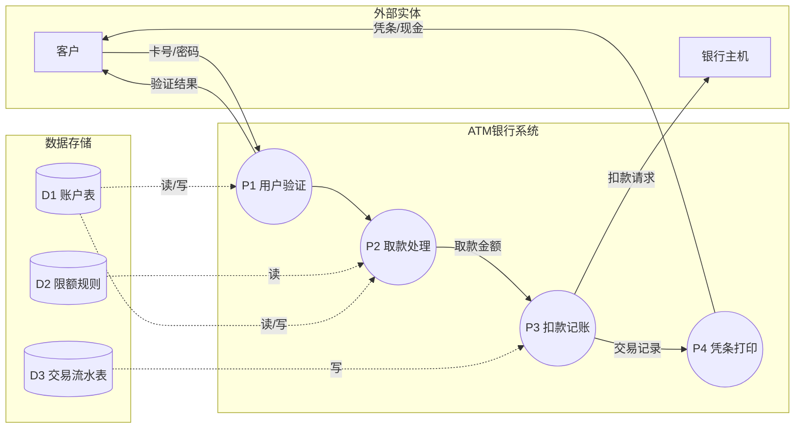
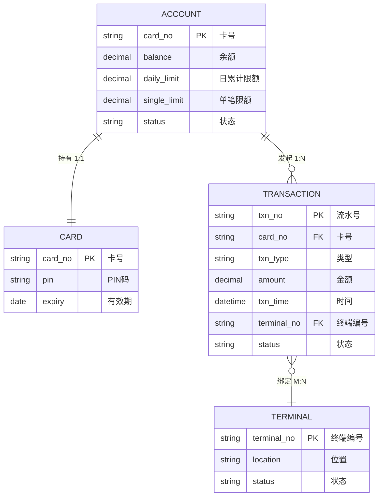
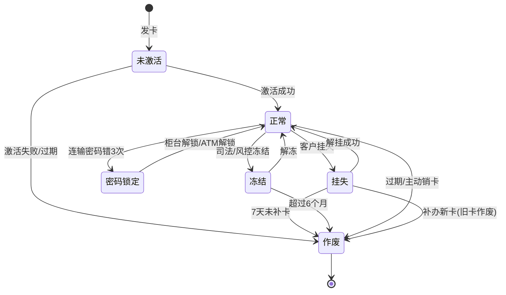

# 软件工程基础教学笔记(四):结构化分析 · ERD · DFD

> 课程编号:26SEB04
> 主题:结构化分析思想、数据流图(DFD)、实体-关系图(ERD)、数据字典、处理说明
> 前置:26SEB01-03(软件工程基础、三要素、Git/WBS/Gantt)
> 预告:26SEB05 UML 与面向对象分析设计(OOA/OOD)

---

## 目录

1. [结构化分析思想](#1-结构化分析思想)
2. [数据流图 DFD](#2-数据流图-dfd)
3. [实体-关系图 ERD](#3-实体-关系图-erd)
4. [STD 状态转换图](#4-std-状态转换图)
5. [数据字典](#5-数据字典)
6. [处理说明:判定表与判定树](#6-处理说明判定表与判定树)
7. [ATM 系统结构化分析实战](#7-atm-系统结构化分析实战)
8. [结构化分析 vs 面向对象分析](#8-结构化分析-vs-面向对象分析)
9. [速览总结](#9-速览总结)

---

## 1. 结构化分析思想

### 1.1 什么是结构化分析

**结构化分析(Structured Analysis,简称 SA)** 是 1970-80 年代流行的需求分析方法,由 DeMarco、Yourdon 等人发展,用于**自顶向下、逐层分解**地理解系统需求。

> 核心思想:**将系统看作"数据流的加工过程",通过追踪数据的来源、加工、存储、去向,逐步拆解出系统的功能需求。**

### 1.2 历史定位

| 时代 | 方法 | 代表工具 |
|------|------|----------|
| 1960s | 无方法,自由编程 | — |
| **1970-80s** | **结构化方法(SA/SD)** | **DFD、ERD、数据字典** |
| 1990s+ | 面向对象方法(OOA/OOD) | UML、Use Case、类图 |

### 1.3 结构化分析的核心假设

1. **系统 = 数据 + 加工**:系统本质是对数据进行一系列加工处理
2. **分层分解**:从顶层系统逐层分解为子过程,直到每个过程足够简单
3. **图形化表达**:用标准符号画图,直观易读
4. **文档驱动**:分析阶段产出的图和字典是后续设计的输入

### 1.4 SA 的输出物(需求规格说明书的核心)

| 输出物 | 回答什么问题 |
|--------|--------------|
| **DFD 数据流图** | 数据如何流动、被如何加工 |
| **ERD 实体-关系图** | 有哪些数据实体、它们之间什么关系 |
| **数据字典** | 每个数据项的精确定义 |
| **处理说明** | 每个加工做什么(输入/输出/逻辑) |

### 1.5 SA 四件套关系

```
DFD(数据流动) ──→ 处理说明(加工逻辑)
     │                │
     ↓                ↓
数据字典(数据定义) ←── ERD(数据实体关系)
```

---

## 2. 数据流图 DFD

### 2.1 什么是 DFD

**DFD(Data Flow Diagram,数据流图)** 是结构化分析中最核心的建模工具,用图形符号描述**数据在系统中的流动和加工过程**。

> DFD 只回答:**数据从哪来 → 经过什么加工 → 存到哪 → 到哪去**。不描述"怎么做"。

### 2.2 DFD 四种基本符号

| 符号 | 名称 | 图形 | 说明 | 示例 |
|------|------|------|------|------|
| **外部实体** | External Entity | 矩形 | 系统外的人/系统,数据的源和宿 | 客户、银行主机 |
| **加工** | Process | 圆或圆角矩形 | 对数据进行变换处理 | 取款、验密、扣款 |
| **数据存储** | Data Store | 开口矩形 | 系统中持久化的数据仓库 | 账户表、交易流水表 |
| **数据流** | Data Flow | 带箭头的线 | 数据的流动方向,线上标注数据流名 | 取款请求、账户余额 |

**标准画法:**

```
外部实体 ──数据流──→ 加工 ──数据流──→ 数据存储
                    ↑
                    └──数据流──┘
```

### 2.3 DFD 分层原则

DFD 采用**自顶向下逐层分解**的策略,形成多层图:

| 层级 | 名称 | 内容 |
|------|------|------|
| **0 层** | 上下文图(Context Diagram) | 只有一个"系统"加工,展示系统与外部实体的交互 |
| **1 层** | 顶层 DFD | 把"系统"分解为主要子过程 |
| **2 层及以下** | 底层 DFD | 把 1 层的某个加工继续细化 |

### 2.4 分层的平衡原则(父图与子图一致性)

> **父图中某个加工的输入/输出数据流,必须与子图中所有加工的输入/输出数据流之和完全对应(不增不减)。**

示例:
```
父图:  取款系统 ←账户信息→
                    ↓
子图:  验密加工 ←账户信息→ 扣款加工 ←账户信息→ ...
       (每个子加工都用到"账户信息"数据流)
       → 子图的输入/输出 = 父图的输入/输出 ✓
```

### 2.5 ATM 取款 DFD(实战)

> 完整分层图见第 6 节 ATM 实战。

**DFD 0 层(上下文图):**

```
┌──────┐                    ┌──────────────┐                    ┌──────┐
│ 客户 │ ──插卡/取款请求──→ │              │ ──扣款请求──→       │银行主机│
└──────┘                    │ ATM 银行系统  │                    └──────┘
┌──────┐                    │              │                    ┌──────┐
│ 运维 │ ──终端状态查询──→ │              │ ──交易流水──→       │银行主机│
└──────┘                    └──────────────┘                    └──────┘
```

**DFD 1 层(顶层分解):**

```
客户 ──→ 【P1 验密】 ──→ 【P2 取款处理】 ──→ 【P3 扣款记账】 ──→ 银行主机
          ↑                  ↑                  ↑
          │                  │                  │
       D1 账户表          D2 限额规则          D3 流水表
```

---

## 3. 实体-关系图 ERD

### 3.1 什么是 ERD

**ERD(Entity-Relationship Diagram,实体-关系图)** 描述系统中**数据实体及其相互关系**,是数据建模的核心工具。

> ERD 关注:**有哪些数据对象、它们是什么关系、有什么属性**。是数据库设计的前置。

### 3.2 ERD 三种基本符号

| 符号 | 名称 | 图形 | 说明 | 示例 |
|------|------|------|------|------|
| **实体** | Entity | 矩形 | 独立存在的数据对象 | 账户、交易、卡片 |
| **属性** | Attribute | 椭圆 | 实体的特征,主键加下划线 | 卡号、余额、限额 |
| **关系** | Relationship | 菱形 | 实体间的联系,动宾结构 | 持有、发起、记录 |

### 3.3 关系的基数(Cardinality)

基数表示两个实体间关联的数量约束:

| 关系 | 含义 | ATM 示例 |
|------|------|----------|
| **1:1** | 一个 A 对应一个 B | 账户 ↔ 卡片(一张卡对应一个账户) |
| **1:N** | 一个 A 对应多个 B | 账户 → 交易(一个账户有多笔交易) |
| **M:N** | 多个 A 对应多个 B | 账户 ↔ ATM(一个账户可在多台 ATM 操作) |

**标准画法:**

```
┌────────┐     ┌──────┐     ┌────────┐
│  账户   │ ──1:N── │ 发起 │ ──M:1── │  交易   │
└────────┘     └──────┘     └────────┘
   │              │              │
  卡号          ——             流水号
  余额                        金额
  限额                        时间
```

### 3.4 主键与外键

| 概念 | 说明 | ATM 示例 |
|------|------|----------|
| **主键(PK)** | 唯一标识一个实体的属性组合 | 账户表:卡号;交易表:流水号 |
| **外键(FK)** | 在关联表中引用另一表主键的属性 | 交易表中的"卡号"引用账户表的"卡号" |

### 3.5 数据模型三层演进:概念 → 逻辑 → 物理 → SQL

从需求到建表,数据建模经历**三个抽象层次**的逐层细化:

```
概念模型(ERD)  ──→  逻辑模型(关系表)  ──→  物理模型(DDL设计)  ──→  SQL DDL
  是什么              存什么结构              具体怎么存              执行建表
  与DB无关            与DB无关                与DB相关                MySQL/Oracle...
```

#### 第一层:概念模型(Conceptual Model)

**工具**:ERD(实体-关系图)
**关注点**:业务中有哪些实体、什么关系、什么属性
**特点**:与数据库无关,纯业务视角

**ATM 概念模型:**

| 实体 | 属性 | 主键 | 关系 |
|------|------|------|------|
| 账户 | 卡号、余额、限额、状态 | 卡号 | 1:1 持有 卡片 |
| 卡片 | 卡号、PIN、有效期 | 卡号 | 1:N 发起 交易 |
| 交易 | 流水号、卡号、金额、时间 | 流水号 | N:1 绑定 终端 |
| 终端 | 终端号、位置、状态 | 终端号 | — |

#### 第二层:逻辑模型(Logical Model)

**工具**:关系表设计(Relational Schema)
**关注点**:实体→表、属性→字段、关系→外键、范式规范化
**特点**:与具体 DBMS 无关,只关心结构

**转换规则:**

| ERD 元素 | 逻辑模型转换 |
|----------|-------------|
| 实体 | → 一张关系表 |
| 属性 | → 表字段(含数据类型) |
| 主键 | → 表 PRIMARY KEY |
| 1:N 关系 | → 在"多"端表加外键引用"1"端主键 |
| M:N 关系 | → 新建中间表,两端各加外键 |
| 1:1 关系 | → 任一端加外键(通常在子表) |

**ATM 逻辑模型:**

```
账户表(account):
  卡号(VARCHAR 19) PK, 余额(DECIMAL 12,2), 单笔限额(DECIMAL 10,2), 日累计限额(DECIMAL 10,2), 状态(VARCHAR 10)

卡片表(card):
  卡号(VARCHAR 19) PK/FK→account, PIN(VARCHAR 6), 有效期(DATE)

交易表(transaction):
  流水号(VARCHAR 20) PK, 卡号(VARCHAR 19) FK→account, 终端号(VARCHAR 10) FK→terminal,
  类型(VARCHAR 10), 金额(DECIMAL 10,2), 时间(DATETIME), 状态(VARCHAR 10)

终端表(terminal):
  终端号(VARCHAR 10) PK, 位置(VARCHAR 50), 状态(VARCHAR 10)
```

**M:N 关系示例**(如果存在"账户 ↔ 终端 M:N"的操作记录):

```
操作记录表(account_terminal):           ← 中间表
  卡号(VARCHAR 19) FK→account, 
  终端号(VARCHAR 10) FK→terminal, 
  操作时间(DATETIME)
  PK(卡号, 终端号, 操作时间)           ← 联合主键
```

#### 第三层:物理模型(Physical Model)

**工具**:具体 DBMS 的 DDL 设计
**关注点**:字段类型、索引、约束、存储引擎、分区、字符集
**特点**:与具体 DBMS 强相关

**逻辑→物理转换的关键决策:**

| 决策项 | MySQL 选择 | Oracle 选择 | 说明 |
|--------|-----------|-------------|------|
| 主键策略 | `BIGINT AUTO_INCREMENT` 或 `VARCHAR` | `NUMBER` + Sequence | 业务主键 vs 代理主键 |
| 金额类型 | `DECIMAL(12,2)` | `NUMBER(12,2)` | 必须精确,禁止 FLOAT |
| 字符串 | `VARCHAR(n)` | `VARCHAR2(n)` | Oracle 用 VARCHAR2 |
| 时间 | `DATETIME` | `DATE`/`TIMESTAMP` | MySQL DATETIME 含时分秒 |
| 存储引擎 | `InnoDB` | 默认 | 支持事务和外键 |
| 字符集 | `utf8mb4` | `AL32UTF8` | 支持中文和 emoji |
| 索引 | `INDEX idx_xxx(字段)` | `CREATE INDEX` | 高频查询字段建索引 |
| 外键约束 | `FOREIGN KEY` | `FOREIGN KEY` | 物理约束 or 逻辑约束 |
| 软删除 | `TINYINT is_deleted` | `NUMBER(1) is_deleted` | 避免物理删除丢数据 |
| 审计字段 | `created_at / updated_at` | `CREATED / MODIFIED` | 谁在什么时候改的 |

**ATM 物理模型决策:**

| 决策 | 选择 | 理由 |
|------|------|------|
| 主键策略 | 业务主键(卡号/流水号) | 金融系统业务主键有实际意义 |
| 金额类型 | `DECIMAL(12,2)` | 精度优先 |
| 外键 | 逻辑约束(不建物理 FK) | 金融系统性能优先,应用层保证一致性 |
| 软删除 | 不采用 | 交易/账户数据必须保留,禁用用状态字段 |
| 审计字段 | `created_at / updated_at` | 合规要求可追溯 |
| 存储引擎 | `InnoDB` | 事务支持 |

#### 第四层:SQL DDL

**工具**:SQL 语句
**产出**:可直接执行的建表脚本

**ATM 系统 MySQL DDL:**

```sql
-- ============================================
-- ATM 银行系统 DDL(MySQL 8.0)
-- 字符集:utf8mb4  引擎:InnoDB
-- ============================================

-- 1. 账户表
CREATE TABLE account (
    card_no         VARCHAR(19)     NOT NULL COMMENT '卡号(主键)',
    balance         DECIMAL(12,2)  NOT NULL DEFAULT 0.00 COMMENT '余额',
    single_limit    DECIMAL(10,2)  NOT NULL DEFAULT 5000.00 COMMENT '单笔限额',
    daily_limit     DECIMAL(10,2)  NOT NULL DEFAULT 20000.00 COMMENT '日累计限额',
    status          VARCHAR(10)     NOT NULL DEFAULT 'NORMAL' COMMENT '状态:NORMAL/LOCKED/FROZEN/LOST/EXPIRED/CANCELLED',
    created_at      DATETIME        NOT NULL DEFAULT CURRENT_TIMESTAMP,
    updated_at      DATETIME        NOT NULL DEFAULT CURRENT_TIMESTAMP ON UPDATE CURRENT_TIMESTAMP,
    PRIMARY KEY (card_no),
    INDEX idx_status (status)
) ENGINE=InnoDB DEFAULT CHARSET=utf8mb4 COMMENT='账户表';

-- 2. 卡片表(1:1 持有)
CREATE TABLE card (
    card_no         VARCHAR(19)     NOT NULL COMMENT '卡号(主键+外键)',
    pin             VARCHAR(6)      NOT NULL COMMENT 'PIN码(加密存储)',
    expiry_date     DATE            NOT NULL COMMENT '有效期',
    failed_count    TINYINT         NOT NULL DEFAULT 0 COMMENT '连续输密失败次数',
    status          VARCHAR(10)     NOT NULL DEFAULT 'ACTIVE' COMMENT '状态:ACTIVE/INACTIVE/LOCKED/LOST/EXPIRED',
    created_at      DATETIME        NOT NULL DEFAULT CURRENT_TIMESTAMP,
    updated_at      DATETIME        NOT NULL DEFAULT CURRENT_TIMESTAMP ON UPDATE CURRENT_TIMESTAMP,
    PRIMARY KEY (card_no),
    CONSTRAINT fk_card_account FOREIGN KEY (card_no) REFERENCES account(card_no)
) ENGINE=InnoDB DEFAULT CHARSET=utf8mb4 COMMENT='卡片表';

-- 3. 终端表
CREATE TABLE terminal (
    terminal_no     VARCHAR(10)     NOT NULL COMMENT '终端编号(主键)',
    location        VARCHAR(50)     NOT NULL COMMENT '安装位置',
    status          VARCHAR(10)     NOT NULL DEFAULT 'ONLINE' COMMENT '状态:ONLINE/OFFLINE/MAINTENANCE',
    last_heartbeat  DATETIME        COMMENT '最后心跳时间',
    created_at      DATETIME        NOT NULL DEFAULT CURRENT_TIMESTAMP,
    updated_at      DATETIME        NOT NULL DEFAULT CURRENT_TIMESTAMP ON UPDATE CURRENT_TIMESTAMP,
    PRIMARY KEY (terminal_no),
    INDEX idx_status (status)
) ENGINE=InnoDB DEFAULT CHARSET=utf8mb4 COMMENT='ATM终端表';

-- 4. 交易表(核心流水)
CREATE TABLE transaction (
    txn_no          VARCHAR(20)     NOT NULL COMMENT '流水号(主键)',
    card_no         VARCHAR(19)     NOT NULL COMMENT '卡号(外键)',
    terminal_no     VARCHAR(10)     NOT NULL COMMENT '终端编号(外键)',
    txn_type        VARCHAR(10)     NOT NULL COMMENT '类型:WITHDRAW/DEPOSIT/TRANSFER/BALANCE',
    amount          DECIMAL(10,2)   NOT NULL COMMENT '交易金额',
    balance_after   DECIMAL(12,2)  NOT NULL COMMENT '交易后余额',
    status          VARCHAR(10)     NOT NULL COMMENT '状态:SUCCESS/FAIL/PENDING',
    fail_reason     VARCHAR(50)     COMMENT '失败原因',
    txn_time        DATETIME        NOT NULL COMMENT '交易时间',
    created_at      DATETIME        NOT NULL DEFAULT CURRENT_TIMESTAMP,
    PRIMARY KEY (txn_no),
    INDEX idx_card_time (card_no, txn_time),
    INDEX idx_terminal_time (terminal_no, txn_time),
    INDEX idx_status (status)
) ENGINE=InnoDB DEFAULT CHARSET=utf8mb4 COMMENT='交易流水表';
```

**DDL 设计要点:**

| 要点 | 说明 | 金融场景特殊要求 |
|------|------|------------------|
| **金额用 DECIMAL** | 禁止 FLOAT/DOUBLE | 精度是硬指标 |
| **外键可选** | 金融系统常用逻辑外键 | 性能优先,应用层保证一致性 |
| **索引设计** | 高频查询字段建索引 | 卡号+时间联合索引(查交易历史) |
| **状态字段** | 用 VARCHAR + 注释说明取值 | 比 TINYINT 可读性好 |
| **审计字段** | `created_at / updated_at` | 合规要求可追溯 |
| **流水号生成** | `日期+终端号+序号` | 唯一且有业务含义 |
| **交易后余额** | 冗余存储 | 避免每次 JOIN 账户表,查询快 |

#### 三层模型对比总结

| 维度 | 概念模型(ERD) | 逻辑模型(关系表) | 物理模型(DDL) |
|------|--------------|-----------------|---------------|
| **回答问题** | 业务上有什么 | 数据怎么组织 | 在 DB 里怎么存 |
| **与 DB 关系** | 完全无关 | 无关 | 强相关 |
| **产出物** | ER 图 | 关系表设计 | DDL 脚本 |
| **规范** | ER 建模规范 | 关系代数 + 范式 | DBMS 语法 + 最佳实践 |
| **ATM 示例** | 4 实体 + 3 关系 | 4 张表 + 主键外键 | MySQL DDL 4 张表 + 索引 + 约束 |

#### 工具链

| 阶段 | 常用工具 |
|------|----------|
| 概念建模 | PowerDesigner、Visio、draw.io |
| 逻辑建模 | PowerDesigner、ER/Studio |
| 物理建模 + DDL | PowerDesigner(自动生成)、Navicat、DBeaver |
| 代码生成 | MyBatis Generator、JPA Metamodel |

> 💡 **一句话总结**:ERD 是概念模型(业务视角),转换为关系表是逻辑模型(结构视角),细化为具体 DDL 是物理模型(存储视角),三层逐层细化,最终生成可执行的建表 SQL。金融场景中金额必须用 DECIMAL、审计字段不可少、外键常用逻辑约束。

### 3.6 ATM ERD(实战)

> 完整 ERD 图见第 7 节 ATM 实战。

---

## 4. STD 状态转换图

### 4.1 什么是 STD

**STD(State Transition Diagram,状态转换图)** 是结构化分析的**第五件套**,描述**一个实体在生命周期中经历的所有状态及触发状态转换的事件**。

> DFD 看"数据如何流",ERD 看"数据是什么",**STD 看"数据会变成什么状态"**。

### 4.2 STD 三种基本符号

| 符号 | 图形 | 说明 |
|------|------|------|
| **状态** | 圆角矩形 | 实体的某个稳定状态,内部可写状态名 |
| **转换** | 带箭头的线 | 标注 **事件[条件]/动作**,如"输错密码3次[正常]→锁定" |
| **初始伪状态** | 实心圆 | 状态图的起点,无状态名 |
| **终态** | 实心圆套圆圈 | 生命周期终点,不再转换 |

### 4.3 STD 核心概念

| 概念 | 说明 | 示例 |
|------|------|------|
| **状态** | 实体在某一时刻的稳定属性值集合 | 卡的"正常""挂失""锁定" |
| **事件** | 触发状态转换的外部信号 | 插卡、输密、挂失申请 |
| **守卫条件** | 事件触发前必须满足的条件,写在 `[]` 中 | `[密码正确]`、`[余额≥取款额]` |
| **动作** | 转换时执行的操作,写在 `/` 后 | `/扣款`、`/记录流水` |
| **自转换** | 同一状态上的转换,通常表示内部事件 | 正常状态下持续查询余额 |

### 4.4 状态转换的完整语法

```
事件[守卫条件]/动作
```

**ATM 示例:**
```
插卡[卡=正常] → 正常(进入交易)
输密[密码正确] → 正常(验密通过)
输密[密码错误 ∧ 错误次数<3] → 正常(继续等待输入)
输密[密码错误 ∧ 错误次数≥3] → 密码锁定
挂失申请 → 挂失
```

### 4.5 STD vs 其他建模工具

| 对比项 | STD | DFD | ERD |
|--------|-----|-----|-----|
| 关注点 | 状态变化 | 数据流动 | 数据实体 |
| 回答问题 | 什么时候变? | 数据从哪来到哪去? | 有哪些数据对象? |
| 建模对象 | 单个实体的生命周期 | 整个系统的数据加工 | 系统的数据结构 |
| 粒度 | 细(每个状态转换) | 中(加工+数据流) | 粗(实体+关系) |

### 4.6 SA 五件套关系

```
DFD(数据流动) ──→ 处理说明(加工逻辑)
     │                │
     ↓                ↓
数据字典(数据定义) ←── ERD(数据实体关系)
     │
     ↓
STD(实体状态变化) ← 补充异常/边界行为
```

> 💡 DFD + ERD + 数据字典 + 处理说明 = **SA 四件套**,加上 STD = **SA 五件套**。STD 是唯一一个描述**时间维度**的工具,补充了 DFD/ERD 没覆盖的异常边界行为。

---

## 5. 数据字典

### 5.1 什么是数据字典

**数据字典(Data Dictionary)** 是对 DFD 中**所有数据元素的精确定义**的集合,是沟通分析者、开发者、测试者的"数据标准"。

### 5.2 数据字典条目类型

| 类型 | 说明 | 示例 |
|------|------|------|
| **数据流** | DFD 中流动的数据定义 | 取款请求 = 卡号 + 金额 + 密码 |
| **数据存储** | DFD 中存储的数据定义 | 账户表 = {卡号, 余额, 限额, 状态} |
| **数据项** | 不可再分的最小数据单位 | 金额 = 9 位数字,两位小数,单位:元 |
| **加工** | DFD 中加工的逻辑说明 | 取款处理:校验金额→校验限额→扣款→出钞 |

### 5.3 数据字典条目格式

**ATM 取款系统数据字典片段:**

```
=== 数据流 ===
数据流名:取款请求
    组成:卡号 + 密码 + 取款金额 + 终端编号
    来源:客户
    去向:P2 取款处理

=== 数据存储 ===
存储名:账户表(D1)
    组成:卡号 + 余额 + 单笔限额 + 日累计限额 + 状态
    主键:卡号
    组织方式:按卡号索引

=== 数据项 ===
数据项名:取款金额
    类型:数值
    长度:9,2
    单位:元
    取值范围:(0, 5000] 且为 100 的整数倍
    备注:单笔限额 5000,日累计限额 20000
```

---

## 6. 处理说明:判定表与判定树

### 6.1 处理说明的必要性

DFD 展示了数据如何流动,但没说**每个加工内部的逻辑**。处理说明就是补这个缺口。

### 6.2 判定表(Decision Table)

判定表适合表达**多条件组合**的加工逻辑。

**ATM 取款规则:**
- 金额非法(≤0 或非 100 倍数)→ 拒绝
- 单笔超限(>5000)→ 拒绝
- 日累计超限(>20000)→ 拒绝
- 余额不足 → 拒绝
- 以上都不满足 → 扣款出钞

| 条件 | 规则1 | 规则2 | 规则3 | 规则4 | 规则5 |
|------|-------|-------|-------|-------|-------|
| 金额非法? | ✓ | — | — | — | — |
| 单笔超限? | — | ✓ | — | — | — |
| 日累计超限? | — | — | ✓ | — | — |
| 余额不足? | — | — | — | ✓ | — |
| **动作** | | | | | |
| 拒绝取款 | ✓ | ✓ | ✓ | ✓ | — |
| 扣款出钞 | — | — | — | — | ✓ |

### 6.3 判定树(Decision Tree)

判定树用**树形结构**表达逻辑,比判定表更直观,适合条件有先后顺序的情况。

```
取款请求
├── 金额非法? → 拒绝
├── 金额合法
│   ├── 单笔超限? → 拒绝
│   ├── 单笔未超限
│   │   ├── 日累计超限? → 拒绝
│   │   ├── 日累计未超限
│   │   │   ├── 余额不足? → 拒绝
│   │   │   └── 余额充足 → 扣款出钞 ✓
```

### 6.4 判定表 vs 判定树

| 对比项 | 判定表 | 判定树 |
|--------|--------|--------|
| 表达能力 | 强(穷尽所有组合) | 中(有遗漏可能) |
| 直观性 | 需培训 | 一看就懂 |
| 适用场景 | 条件独立、组合多 | 条件有先后顺序 |
| ATM 取款 | 条件独立,适合 | 条件有优先级,也适合 |

---

## 7. ATM 系统结构化分析实战

### 7.1 ATM 取款业务流程(回顾)

```
插卡 → 验密 → 选取款 → 输金额 → 余额校验 → 限额校验 → 扣款记账 → 出钞 → 凭条 → 退卡
```

### 7.2 DFD 0 层:上下文图

系统作为一个黑盒,只展示与外部实体的交互:

```
┌──────┐                                          ┌──────────┐
│ 客户 │ ──1.插卡/2.密码/3.取款请求──→ ┌─────────┐ ──扣款请求──→ ┌──────────┐
│      │ ←──凭条/现金/余额/提示信息── │          │ ←──扣款响应── │ 银行主机 │
└──────┘                              │ ATM银行   │              └──────────┘
┌──────┐ ──4.终端状态──→              │ 系统      │
│ 运维 │ ←──终端状态报告──             │          │
└──────┘                              └─────────┘
                                      ↑
                                      │ 内部:验证/取款/记账/打印
```

### 7.3 DFD 1 层:顶层分解

将"ATM 银行系统"分解为 4 个主要加工:

```
客户 ──→ 【P1 用户验证】 ──→ 【P2 取款处理】 ──→ 【P3 扣款记账】 ──→ 【P4 凭条打印】
          ↑   ↓                ↑   ↓                ↑   ↓
          │                    │                    │
       D1 账户表             D2 限额规则          D3 交易流水表
```

**Mermaid 可视化(在支持 Mermaid 的 Markdown 预览器中渲染):**



| 加工 | 输入 | 输出 | 说明 |
|------|------|------|------|
| P1 用户验证 | 卡号、密码 | 验证结果(通过/拒绝) | 验密、检查卡状态 |
| P2 取款处理 | 取款金额、账户信息 | 扣款请求、出钞指令 | 校验金额/限额/余额 |
| P3 扣款记账 | 扣款请求 | 交易记录、扣款响应 | 更新账户余额、写流水 |
| P4 凭条打印 | 交易记录 | 凭条 | 打印交易信息 |

### 7.4 DFD 2 层:P2 取款处理细化

将 P2 取款处理继续分解:

```
账户信息 ──→ 【P2.1 金额校验】 ──→ 【P2.2 单笔限额校验】 ──→ 【P2.3 日累计校验】 ──→ 【P2.4 余额校验】 ──→ 扣款请求
                ↑                    ↑                    ↑                    ↑
                │                    │                    │                    │
           取款金额               D2 限额规则          D3 当日累计额          D1 账户余额
```

### 7.5 ERD:ATM 核心实体关系



**实体属性:**

| 实体 | 属性 | 主键 |
|------|------|------|
| **账户** | 卡号, 余额, 单笔限额, 日累计限额, 状态 | 卡号 |
| **卡片** | 卡号, 磁道信息, 有效期, PIN | 卡号 |
| **交易** | 流水号, 卡号, 类型, 金额, 时间, 终端编号 | 流水号 |
| **终端** | 终端编号, 位置, 状态, 维护人 | 终端编号 |

**关系:**

| 关系 | 实体对 | 基数 | 外键 |
|------|--------|------|------|
| 持有 | 账户 ↔ 卡片 | 1:1 | 卡片表 FK:卡号 |
| 发起 | 账户 → 交易 | 1:N | 交易表 FK:卡号 |
| 绑定 | 终端 ↔ 交易 | 1:N | 交易表 FK:终端编号 |

### 7.5.1 STD:银行卡状态转换图

**STD(State Transition Diagram,状态转换图)** 是结构化分析的第五件套(SA 五件套),描述**一个实体在生命周期中经历的状态及触发状态转换的事件**。

> DFD 看"数据如何流",ERD 看"数据是什么",**STD 看"数据会变成什么状态"**。

#### 卡的状态图

银行卡在 ATM 系统中的完整生命周期:



| 状态 | 说明 | 进入事件 | 退出事件 |
|------|------|----------|----------|
| **未激活** | 新发卡,未启用 | 发卡 | 激活/过期 |
| **正常** | 可正常使用 | 激活/解挂/解锁/解冻 | 挂失/锁卡/冻结/过期 |
| **密码锁定** | 输错密码 3 次 | 连续输错 3 次 | 柜台/ATM 解锁 |
| **挂失** | 客户挂失 | 客户申请 | 解挂/7 天后作废 |
| **冻结** | 司法/风控冻结 | 法院/风控指令 | 解冻/超期作废 |
| **作废** | 不可用(终态) | 过期/销卡/补卡/解冻/超期 | — |

#### STD 三种基本符号

| 符号 | 图形 | 说明 |
|------|------|------|
| **状态** | 圆角矩形 | 实体的某个状态,圆角双线 = 终态 |
| **转换** | 带箭头的线 | 标注**事件[条件]/动作**,如"[余额充足]→扣款" |
| **初始伪状态** | 实心圆 | 状态图的起点 |

#### ATM 取款流程中卡的状态变化

```
正常 ──插卡──→ 正常 ──验密通过──→ 正常 ──扣款成功──→ 正常(余额减少)
                  │
                  └──验密失败3次──→ 密码锁定
                  └──卡已挂失──→ 挂失(拒绝交易)
                  └──卡已过期──→ 作废(拒绝交易)
```

#### STD 在 ATM 系统中的价值

| 价值 | 说明 |
|------|------|
| **需求补全** | DFD/ERD 没说清"密码输错 3 次后卡会怎样",STD 补充 |
| **边界条件** | 正常状态≠唯一状态,必须考虑所有异常状态 |
| **异常处理** | 密码锁定、挂失、冻结时系统行为不同,必须逐一设计 |
| **测试用例** | 每个状态转换 = 一条测试用例(如"未激活卡插 ATM 应提示什么") |

> 💡 **SA 五件套**:DFD + ERD + 数据字典 + 处理说明 + **STD**(状态转换图)。DFD 看流动,ERD 看实体,STD 看状态变化,三者互补覆盖系统全貌。

---

### 7.5.2 ERD 中的数据类型:为什么金额用 DECIMAL 而非 FLOAT/DOUBLE

#### 问题:为什么不直接用 FLOAT/DOUBLE

`FLOAT`/`DOUBLE` 是**二进制浮点数**,而 `DECIMAL` 是**十进制定点数**。金融场景中,精度误差会导致**资金损失**。

**精度丢失演示:**

```java
// Java
float a = 0.1f;
float b = 0.2f;
System.out.println(a + b);  // 期望 0.3,实际 0.30000004

// 累加 1000 笔 0.01 元交易
float sum = 0;
for (int i = 0; i < 1000; i++) sum += 0.01f;
System.out.println(sum);   // 期望 10.00,实际 9.999998...
```

#### 根本原因

FLOAT/DOUBLE 用**二进制科学计数法**存储,而 0.1、0.01 等在二进制中是**无限循环小数**:

```
0.1(十进制) = 0.00011001100110011...(二进制,无限循环)
0.01(十进制) = 0.0000001010001111010111...(二进制,无限循环)
```

无限循环小数在有限位存储中必须**截断**,截断就产生误差。类似用 `1/3 ≈ 0.3333` 无法精确表示一样。

#### DECIMAL vs FLOAT/DOUBLE 对比

| 对比项 | FLOAT/DOUBLE | DECIMAL |
|--------|-------------|----------|
| 存储方式 | 二进制科学计数法 | 十进制 BCD 编码 |
| 精度 | **不精确**(约 7-15 位有效数字) | **精确**(用户指定,如 `DECIMAL(12,2)`) |
| 误差 | 有(浮点运算固有限制) | 无 |
| 空间 | 较小(FLOAT=4B,DOUBLE=8B) | 较大(DECIMAL(12,2)≈6B) |
| 速度 | 较快(CPU 硬件浮点) | 略慢(软件模拟十进制) |
| **适用场景** | 科学计算、统计分析 | **金融金额、精确计数** |

#### 金融场景的硬性要求

| 场景 | FLOAT 风险 | DECIMAL 保障 |
|------|-----------|--------------|
| ATM 取款 | 100.00 显示为 99.99 | 精确显示 100.00 |
| 利息计算 | 复利累加差几分钱 | 逐笔精确计算 |
| 跨行清算 | 千万笔累计误差可能达数元 | 每笔精确,总和精确 |
| 对账 | 系统间金额对不上 | 精确匹配 |
| 审计 | 无法解释的差异 | 可追溯可验证 |

> 银行、支付宝、微信支付等所有金融系统,金额类型**强制使用 DECIMAL**,绝不用 FLOAT/DOUBLE。这是行业铁律。

#### 各语言对应类型

| 数据库 | Java | Python | C# |
|--------|------|--------|----|
| `DECIMAL(12,2)` | `BigDecimal` | `Decimal` | `decimal` |
| ❌ 禁用 | ❌ 禁用 `float`/`double` | ❌ 禁用 `float` | ❌ 禁用 `float`/`double` |

#### ATM ERD 字段类型修正

| 实体 | 字段 | 错误类型 | 正确类型 | 理由 |
|------|------|----------|----------|------|
| 账户 | 余额 | FLOAT | `DECIMAL(12,2)` | 金融金额 |
| 账户 | 单笔限额 | DOUBLE | `DECIMAL(10,2)` | 金融金额 |
| 账户 | 日累计限额 | FLOAT | `DECIMAL(10,2)` | 金融金额 |
| 交易 | 金额 | FLOAT | `DECIMAL(10,2)` | 金融金额 |
| 交易 | 流水号 | VARCHAR | `VARCHAR(20)` | 主键,字符串 |
| 终端 | 状态 | INT | `VARCHAR(10)` / `TINYINT` | 枚举,无小数 |

---

### 7.6 数据字典:ATM 核心条目

```
=== 数据项 ===
取款金额: 9,2位小数,单位元,范围(0,5000],100的整数倍
账户余额: 12,2位小数,单位元,范围≥0
卡号:     19位数字
流水号:   20位字符串(日期+终端号+序号)

=== 数据流 ===
取款请求 = 卡号 + 密码 + 取款金额 + 终端编号
扣款响应 = 流水号 + 新余额 + 状态码(成功/失败原因)

=== 数据存储 ===
D1 账户表: 卡号(PK), 余额, 单笔限额, 日累计限额, 状态
D2 限额规则: 客户等级, 单笔限额, 日累计限额
D3 交易流水表: 流水号(PK), 卡号(FK), 终端编号(FK), 类型, 金额, 时间, 状态
```

### 7.7 处理说明:P2 取款处理(判定树)

```
取款请求到达
├── 金额 ≤ 0 或非 100 倍数? → 提示"金额无效",拒绝
├── 单笔金额 > 5000? → 提示"超过单笔限额",拒绝
├── 今日累计 + 本次 > 20000? → 提示"超过日累计限额",拒绝
├── 账户余额 < 取款金额? → 提示"余额不足",拒绝
└── 以上都通过 → 生成扣款请求 → 返回成功
```

### 7.8 SA 产出与 WBS 对应

| WBS 编号 | WBS 名称 | SA 产出 |
|----------|----------|---------|
| 1.1 | 需求规格说明书(SRS) | DFD 分层图 + ERD + 数据字典 + 处理说明 |
| 1.2 | 系统架构设计 | 基于 DFD 加工的子系统划分 |
| 1.4 | 数据库设计 | 基于 ERD 的表结构设计 |
| 2.x | 模块编码 | 基于处理说明的业务逻辑实现 |

---

## 8. 结构化分析 vs 面向对象分析

### 8.1 核心差异

| 维度 | 结构化分析(SA) | 面向对象分析(OOA) |
|------|----------------|------------------|
| **视角** | 数据如何流动(过程导向) | 对象如何交互(数据+行为) |
| **分解依据** | 功能/加工 | 类/对象 |
| **核心模型** | DFD + ERD | UML 用例图 + 类图 |
| **关注点** | 输入-加工-输出(IPO) | 谁(Who)做什么(What) |
| **适用场景** | 数据处理密集型系统 | 交互复杂、对象多样的系统 |

### 8.2 ATM 系统对比

| 分析方法 | ATM 取款核心关注点 |
|----------|-------------------|
| **SA** | 金额校验 → 限额校验 → 扣款记账(数据如何流) |
| **OOA** | Account(账户对象) → withdraw()方法 → Transaction(交易对象)创建(对象如何交互) |

### 8.3 互补而非对立

> 现实中二者常**互补使用**:ERD 用于数据库设计(SA 强项),UML 用于业务交互建模(OOA 强项)。

---

## 9. 速览总结

### 9.1 结构化分析口诀

> **自顶向下逐层分,数据流图追根寻;
> 加工实体数据流,四种符号记分明;
> 数据字典定标准,处理说明讲逻辑;
> DFD ERD 数据字典,三件套要配齐。**

### 9.2 DFD 口诀

> **0层黑盒上下文,1层顶层解系统;
> 2层继续细加工,父图子图要平衡;
> 加工圆、实体方、数据存开口、数据流带箭头。**

### 9.3 STD 状态转换图口诀

> **STD 看状态,实体生命周期描;
> 事件触发转换,守卫条件方括号;
> 正常≠唯一状态,边界异常不能少;
> 五件套齐活:DFD ERD 字典 处理说明 STD。**

### 9.4 ERD 口诀

> **实体矩形属椭圆,关系菱形连中间;
> 主键下划线标注,基数 1:1 1:N M:N;
> ERD 转表三步走:实体变表、属性变字段、关系变外键。**

### 9.4 SA vs OOA 口诀

> **SA 看过程,OOA 看对象;
> SA 追数据怎么流,OOA 看谁在交互;
> 二者互补不矛盾,ERD 配 UML 最常用。**

### 9.5 思考题

1. DFD 的分层平衡原则是什么?如果父图有数据流 A→B,子图中能否出现父图没有的数据流 C?
2. ERD 中,"一个账户对应多张银行卡"是什么基数?如何转换为数据库表?
3. 判定表和判定树各适合什么场景?ATM 取款规则用哪个表达更好?
4. SA 产出如何映射到 WBS 的需求与设计工作包?

---

## 附录:与前后讲的关联

| 26SEB01-03 概念 | 本讲对应 |
|-----------------|----------|
| 软件需求分析阶段 | SA 是需求分析的经典方法 |
| 软件生命周期(需求→设计) | SA 输出是详细设计的输入 |
| WBS 1.0 需求与设计 | SA 产出构成 SRS 的核心内容 |
| 2.3 取款交易模块 | SA 对 2.3 模块做了 DFD + ERD + 处理说明 |
| 甘特图 D1-D13 | SA 主要在需求与设计阶段完成 |
| 100% 原则 | SA 的分层分解也遵循 100% 规则 |

| 26SEB05 预告 | 本讲铺垫 |
|-------------|----------|
| UML 用例图 | SA 上下文图 → OOA 用例图 |
| UML 类图 | ERD → 类图(实体 → 类 + 方法) |
| OOA 过程 | SA 过程思想可迁移到 OOA |
| SE 3.0 AI 辅助 | AI 可根据描述自动生成 DFD/ERD |

---

> 💡 **一句话总结**:结构化分析(SA)是用 DFD 追踪数据流、ERD 建模数据实体、数据字典定义数据元素、处理说明描述加工逻辑的**图形化需求分析方法**,遵循自顶向下逐层分解原则,是软件工程中最经典的需求建模范式。OOA/UML 将作为下讲内容继续展开。

