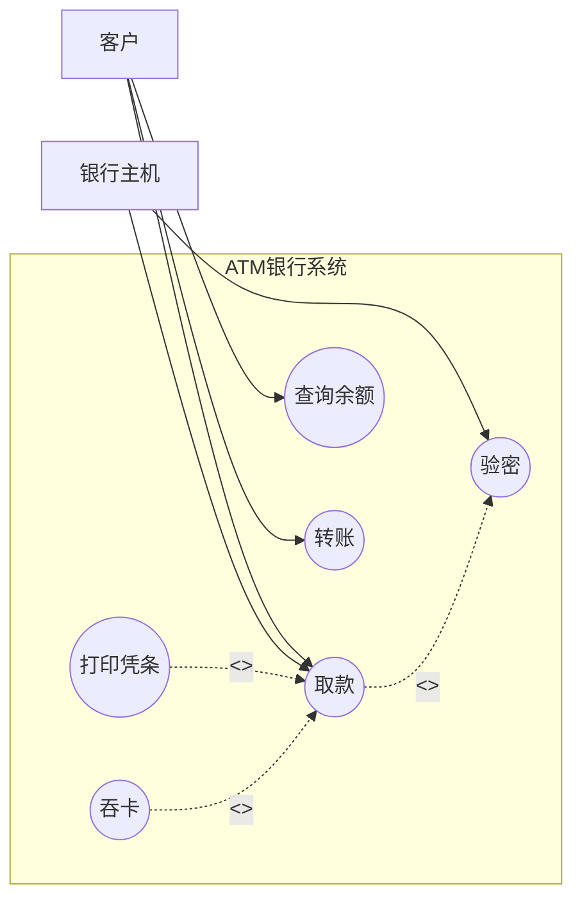
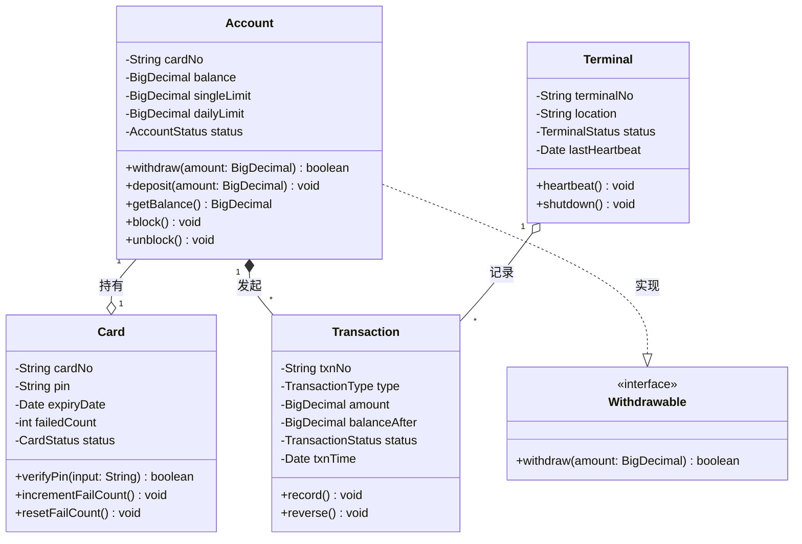
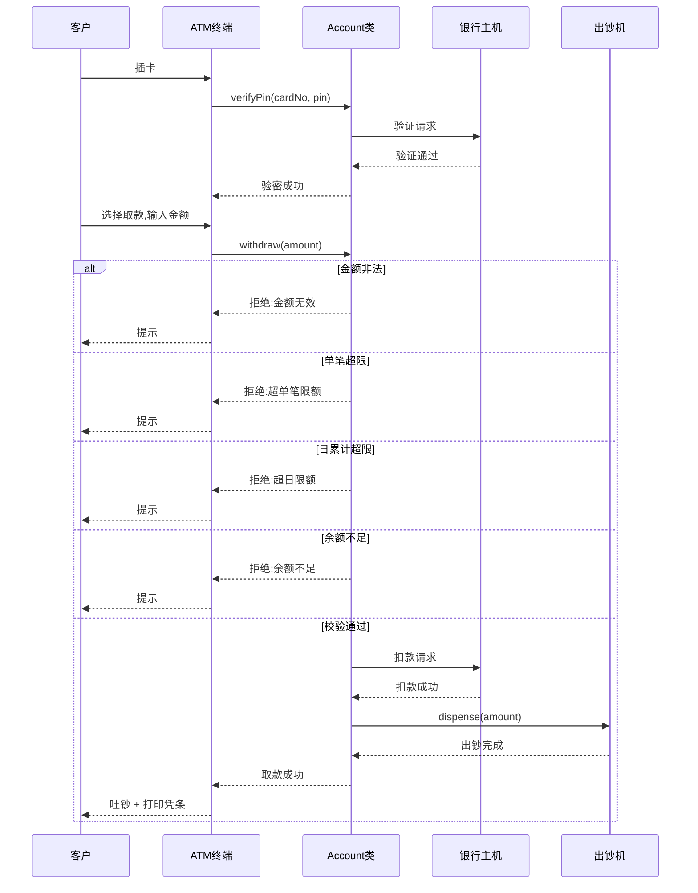

# 软件工程基础教学笔记(五):面向对象分析 · UML · EA · Vibe Coding

> 课程编号:26SEB05
> 主题:OOA 思想、UML 建模(用例图/类图/时序图)、EA MDG 自动化、Vibe Coding AI 辅助
> 前置:26SEB01-04(软件工程基础、三要素、Git/WBS/Gantt、结构化分析)
> 预告:26SEB06 软件设计(架构设计、设计模式、详细设计)

---

## 目录

1. [面向对象分析思想](#1-面向对象分析思想)
2. [UML 建模语言](#2-uml-建模语言)
3. [用例图(Use Case Diagram)](#3-用例图use-case-diagram)
4. [类图(Class Diagram)](#4-类图class-diagram)
5. [时序图(Sequence Diagram)](#5-时序图sequence-diagram)
6. [EA MDG 技术](#6-ea-mdg-技术)
7. [Vibe Coding](#7-vibe-coding)
8. [ATM 系统 OOA 实战](#8-atm-系统-ooa-实战)
9. [SA vs OOA 深度对比](#9-sa-vs-ooa-深度对比)
10. [速览总结](#10-速览总结)

---

## 1. 面向对象分析思想

### 1.1 从 SA 到 OOA 的演进

结构化分析(SA)统治了 1970-80 年代,但面对**交互复杂、对象多样**的系统时显得笨拙。面向对象分析(OOA)应运而生,核心转变:

| 维度 | 结构化分析(SA) | 面向对象分析(OOA) |
|------|----------------|------------------|
| **视角** | 数据如何**流动**(过程导向) | 对象如何**交互**(数据+行为) |
| **分解依据** | 功能/加工 | 类/对象 |
| **核心模型** | DFD + ERD | UML 用例图 + 类图 |
| **范式** | 1970s DeMarco/Yourdon | 1990s Booch/Rumbaugh/Jacobson |

### 1.2 OOA 三大核心原则

#### 封装(Encapsulation)

把**数据(属性)** 和**操作数据的方法**绑定在一起,对外只暴露公共接口,内部细节隐藏。

```
SA:  数据(ERD) + 处理(DFD)     → 分离
OOA: 类 = 数据(属性) + 方法    → 绑定,对外隐藏内部
```

ATM 示例:
```java
// ✅ OOA:Account 类封装余额和扣款逻辑
public class Account {
    private BigDecimal balance;     // 数据隐藏

    public boolean withdraw(BigDecimal amount) {  // 公共接口
        if (amount.compareTo(balance) <= 0) {
            balance = balance.subtract(amount);   // 内部操作
            return true;
        }
        return false;
    }
}
// 外部无法直接修改 balance,必须通过 withdraw() 方法
```

#### 继承(Inheritance)

子类继承父类的属性和方法,可扩展或覆盖,实现**代码复用**和**层次结构**。

```
Payment(支付)                    ← 父类
  ├── WithdrawPayment(取款)       ← 子类:继承 Payment,扩展出钞逻辑
  ├── DepositPayment(存款)        ← 子类:继承 Payment,扩展收钞逻辑
  └── TransferPayment(转账)       ← 子类:继承 Payment,扩展入账逻辑
```

#### 多态(Polymorphism)

同一个方法名,在不同子类中有不同实现,实现**接口统一、行为各异**。

```java
// 统一接口
Payment payment = new WithdrawPayment(...);  // 也可以是 DepositPayment
payment.execute();  // 自动调用对应子类的 execute() 实现
```

### 1.3 OOA 的核心过程

```
1. 识别对象(类)     → 名词提取法
2. 识别属性         → 对象有什么特征
3. 识别方法         → 对象能做什么
4. 识别关系         → 对象之间如何关联
5. 绘制 UML 模型    → 用例图、类图、时序图
6. 验证与迭代       → 检查模型是否覆盖需求
```

### 1.4 OOA vs SA:ATM 案例直观对比

**SA 视角(数据流动):**
```
取款请求 → P1验密 → P2校验金额 → P3校验限额 → P4校验余额 → P5扣款记账 → 出钞
```

**OOA 视角(对象交互):**
```
Customer → Account.withdraw(amount)
           → Account 内部调用 BalanceValidator.validate()
           → Account 内部调用 LimitValidator.validate()
           → Account 内部调用 Ledger.record()
           → Dispenser.dispense(amount)
```

---

## 2. UML 建模语言

### 2.1 什么是 UML

**UML** = **U**nified **M**odeling **L**anguage(统一建模语言),由 Booch、Rumbaugh、Jacobson 三位大师于 1995 年提出,是**面向对象分析与设计的标准建模语言**。

> UML 不是过程,也不是方法,而是一套**图形化建模符号**——像乐谱之于音乐,是表达设计思想的语言。

### 2.2 UML 2.x 图分类(14 种)

| 大类 | 图 | 用途 |
|------|-----|------|
| **结构图**(静态) | 类图、对象图、包图、组件图、部署图、制品图 | 描述系统结构 |
| **行为图**(动态) | 用例图、时序图、协作图、状态机图、活动图、交互概览图、时间图、通信图 | 描述系统行为 |

### 2.3 教学重点:三大核心图

| 图 | 阶段 | 回答问题 | SA 对应 |
|-----|------|----------|---------|
| **用例图** | OOA 需求 | 谁在做什么? | DFD 0 层(上下文图) |
| **类图** | OOA/OOD | 有哪些类、什么关系? | ERD + 数据字典 |
| **时序图** | OOA/OOD | 对象之间如何交互? | DFD 1 层加工流程 + 处理说明 |

> 💡 **三大图对应 SA 五件套**:用例图≈上下文图,类图≈ERD,时序图≈DFD 加工+处理说明,UML 状态机图≈STD。UML 是 SA 的"面向对象升级"。

---

## 3. 用例图(Use Case Diagram)

### 3.1 基本符号

| 符号 | 图形 | 说明 | ATM 示例 |
|------|------|------|----------|
| **执行者(Actor)** | 小人 | 与系统交互的外部实体 | 客户、银行主机、运维 |
| **用例(Use Case)** | 椭圆 | 系统提供的功能 | 取款、查询余额、转账 |
| **关联(Association)** | 实线 | Actor 与 Use Case 的交互 | 客户 → 取款 |
| **包含(include)** | 虚线箭头 + «include» | 必须执行的公共步骤 | 取款 «include» 验密 |
| **扩展(extend)** | 虚线箭头 + «extend» | 可选执行的步骤 | 打印凭条 «extend» 取款 |
| **泛化(generalization)** | 空心三角 | 继承关系 | ATM 取款 泛化 现金操作 |

### 3.2 ATM 用例图(Mermaid)



### 3.3 用例描述模板

| 字段 | 内容 | ATM 示例 |
|------|------|----------|
| 用例名称 | 动词+名词 | 取款 |
| 参与者 | 谁来触发 | 客户 |
| 前置条件 | 执行前必须满足 | 卡已插入、密码已验证 |
| 基本流程 | 主成功场景 | 1. 客户选择取款 2. 输入金额 3. 系统校验 4. 扣款 5. 出钞 |
| 备选流程 | 异常场景 | 3a. 余额不足→提示 3b. 超限→提示 |
| 后置条件 | 执行后系统状态 | 账户余额减少、交易流水记录 |

---

## 4. 类图(Class Diagram)

### 4.1 基本符号

| 符号 | 图形 | 说明 |
|------|------|------|
| **类** | 三层矩形 | 类名 / 属性 / 方法 |
| **属性** | 类中部 | `可见性 属性名:类型 = 默认值` |
| **方法** | 类底部 | `可见性 方法名(参数):返回类型` |
| **可见性** | `+`/`-`/`#` | +public, -private, #protected |

```
┌──────────────┐
│ Account      │  ← 类名
├──────────────┤
│ -cardNo: String     │
│ -balance: BigDecimal │  ← 属性
│ -status: Status      │
├──────────────┤
│ +withdraw(amt): boolean  │
│ +deposit(amt): void      │  ← 方法
│ +getBalance(): BigDecimal │
└──────────────┘
```

### 4.2 类之间的关系

| 关系 | 图形 | 含义 | ATM 示例 |
|------|------|------|----------|
| **依赖(Dependency)** | 虚线箭头 | 临时使用 | 取款临时使用校验器 |
| **关联(Association)** | 实线 | 长期持有引用 | Account 持有 Card |
| **聚合(Aggregation)** | 空心菱形 | 整体-部分(可分离) | ATM 聚合 CardReader |
| **组合(Composition)** | 实心菱形 | 整体-部分(不可分离) | Account 组合 Transaction |
| **泛化(Generalization)** | 空心三角 | 继承 | WithdrawPayment 泛化 Payment |
| **实现(Realization)** | 虚线空心三角 | 实现接口 | Account 实现 Withdrawable |

### 4.3 ATM 类图(Mermaid)



### 4.4 类图 vs ERD

| 对比 | 类图 | ERD |
|------|------|-----|
| **视角** | 对象(数据+行为) | 数据(纯属性) |
| **包含** | 属性 + **方法** + 关系 | 仅属性 + 关系 |
| **继承** | 支持 | 不支持 |
| **封装** | 支持(可见性) | 不支持 |
| **阶段** | OOA/OOD | SA/数据库设计 |
| **ATM 示例** | Account 类有 `withdraw()` 方法 | Account 表只有 `balance` 字段 |

> 💡 **类图 = ERD + 方法 + 继承 + 封装**。ERD 只描述数据结构,类图描述数据结构 + 行为接口。

---

## 5. 时序图(Sequence Diagram)

### 5.1 基本符号

| 符号 | 图形 | 说明 |
|------|------|------|
| **参与者** | 矩形 + 小人 | 外部 Actor |
| **对象** | 矩形 | 类的实例,`objectName:ClassName` |
| **生命线** | 虚线 | 对象存在的时间轴 |
| **激活框** | 实线矩形 | 对象正在执行方法的时间段 |
| **同步消息** | 实线箭头 | 调用方等待返回 |
| **异步消息** | 虚线箭头 | 调用方不等待 |
| **返回消息** | 虚线箭头 + open arrow | 方法返回 |

### 5.2 ATM 取款时序图(Mermaid)



### 5.3 时序图 vs DFD 1 层

| 对比 | 时序图 | DFD 1 层 |
|------|--------|----------|
| **关注** | 对象间**消息传递的时间顺序** | 数据**流向**和加工 |
| **维度** | 时间(谁先谁后) + 交互 | 数据流 + 加工 |
| **分支** | alt/else/opt 清晰表达 | 需判定表/判定树辅助 |
| **对应** | OOA 视角(对象交互) | SA 视角(数据加工) |

---

## 6. EA MDG 技术

### 6.1 什么是 EA

**EA** = **E**nterprise **A**rchitect(企业架构师),是 Sparx Systems 出品的**专业 UML 建模工具**,广泛应用于软件工程、企业架构、系统设计领域。

| 特性 | 说明 |
|------|------|
| **支持 UML 2.5** | 全部 14 种 UML 图 |
| **支持 BPMN/SysML** | 业务流程、系统工程建模 |
| **代码生成** | 模型→Java/C#/Python/DDL |
| **逆向工程** | 代码→UML 类图 |
| **团队协作** | 多用户、版本控制、权限管理 |

### 6.2 什么是 MDG

**MDG** = **M**odel **D**riven **G**eneration(模型驱动生成),是 EA 的核心技术:

> **用模型驱动软件开发,从 UML 模型自动生成代码、DDL、文档,实现"模型即代码"。**

```
UML 模型 ──MDG──→ 源代码(Java/C#/Python)
    │
    ├──→ DDL 脚本
    ├──→ API 文档
    ├──→ 测试用例骨架
    └──→ 框架配置文件
```

### 6.3 MDG 工作流程

```
1. 用 EA 绘制 UML 模型(用例图、类图、时序图)
           ↓
2. 配置 MDG 模板(指定目标语言、框架)
           ↓
3. 一键生成:
   ├── 类图 → Java/C# 实体类 + DAO + Service
   ├── 时序图 → 接口方法签名
   ├── ERD → DDL 建表语句
   └── 用例图 → 需求文档
           ↓
4. AI/人工补充业务逻辑细节
           ↓
5. 编译运行测试
```

### 6.4 MDG vs 传统 CASE 工具

| 对比 | 传统 CASE(Rational Rose) | EA MDG |
|------|--------------------------|--------|
| **代码生成** | 骨架代码,需大量手工补充 | 完整 CRUD + 框架配置 |
| **逆向工程** | 基础支持 | 强(代码→类图→模型) |
| **模型一致性** | 手动维护 | 自动同步 |
| **团队协作** | 弱 | 强(多用户、版本控制) |
| **框架支持** | 通用 | Spring Boot/.NET/Node.js |
| **学习曲线** | 陡峭 | 中等 |

### 6.5 ATM 项目 MDG 实战

**步骤 1:在 EA 中绘制 ATM 类图**(与第 4 节 Mermaid 图一致)

**步骤 2:配置 MDG 模板**

| 配置项 | 选择 |
|--------|------|
| 目标语言 | Java 17 |
| 框架 | Spring Boot 3.x |
| 数据库 | MySQL 8.0 |
| DAO 层 | MyBatis-Plus |
| API 文档 | SpringDoc OpenAPI |

**步骤 3:一键生成**

| UML 模型元素 | MDG 生成 |
|-------------|---------|
| Account 类 | `Account.java` 实体 + `AccountRepository` + `AccountService` |
| Card 类 | `Card.java` + `CardRepository` + `CardService` |
| Transaction 类 | `Transaction.java` + `TransactionRepository` |
| withdraw() 方法 | `AccountService.withdraw()` 接口定义 + Service 层骨架 |
| 4 张表的 ERD | MySQL DDL 建表脚本 |
| 时序图 | Controller 层的方法签名 + 请求/响应 DTO |

**步骤 4:人工补充**

AI/人工在 Service 层补充核心业务逻辑(校验、事务、异常处理),MDG 已搭好骨架,开发者专注业务。

### 6.6 MDG 的价值

| 价值 | 说明 |
|------|------|
| **效率提升** | 70% 的样板代码自动生成 |
| **一致性** | 模型→代码→DDL 自动同步,避免手动不一致 |
| **架构保证** | 统一模板保证架构风格一致 |
| **新人友好** | 新人从生成代码入手,理解架构 |
| **文档自动** | 模型即文档,不会过期 |

### 6.7 MDG 的局限

| 局限 | 说明 | 应对 |
|------|------|------|
| **业务逻辑仍需手写** | MDG 只生成结构,核心逻辑靠人 | AI 辅助 + 人工审查 |
| **生成代码可能过度设计** | MDG 按模板生成,可能引入不需要的层 | 定制模板、精简输出 |
| **模型维护成本** | 代码频繁变更后需同步更新模型 | 逆向工程自动同步 |
| **学习曲线** | EA + MDG 模板需要时间掌握 | 从小项目逐步推广 |

---

## 7. Vibe Coding

### 7.1 什么是 Vibe Coding

**Vibe Coding** 是 Andrej Karpathy(特斯拉 AI 负责人、OpenAI 联合创始人)于 2025 年提出的新概念:

> **不是"写代码",而是"描述想要什么感觉",AI 帮你生成代码,你负责审查和微调。**

| 维度 | 传统编程 | Vibe Coding |
|------|----------|-------------|
| 核心活动 | 写代码 | 写需求(Prompt) |
| 开发者角色 | 代码的**书写者** | 意图的**表达者** + AI 产出的**审查者** |
| 代码来源 | 人逐行写 | AI 生成 |
| 学习重点 | 语法、API、框架 | Prompt 技巧、审查能力 |

### 7.2 Vibe Coding 工作流

```
┌─────────────────────────────────────────────────┐
│ 1. 描述需求:"开发ATM取款功能"                     │
│ 2. AI 生成完整代码(含后端+前端+DDL+测试)           │
│ 3. 审查 AI 产出(架构、安全、质量)                  │
│ 4. 微调补充业务细节                                │
│ 5. 测试、调试、迭代                                │
└─────────────────────────────────────────────────┘
```

### 7.3 Vibe Coding vs MDG

| 对比 | MDG(模型驱动) | Vibe Coding(Prompt 驱动) |
|------|---------------|--------------------------|
| **输入** | UML 模型(类图、时序图) | 自然语言 Prompt |
| **工具** | EA + MDG 插件 | TRAE/Copilot/Cursor |
| **学习曲线** | 需学 UML + EA 工具 | 需学 Prompt 技巧 |
| **生成质量** | 稳定、可预测 | 灵活、可能有幻觉 |
| **灵活性** | 中等(受限于模板) | 高(可随时调整) |
| **适合场景** | 大型企业项目、严格架构 | 快速原型、中小项目、探索性开发 |

### 7.4 Vibe Coding 在 ATM 项目中的应用

**SE 1.0(传统):**
```
手写 500 行 Java → 编译报错 → 修复 → 再编译 → 反复调试
```

**SE 2.0(敏捷+DevOps):**
```
IDE 补全写 200 行 → JUnit 测试 → Jenkins 自动部署
```

**SE 3.0(Vibe Coding):**
```
Prompt:
"实现ATM取款服务(Spring Boot 3 + MySQL 8):
1. POST /api/withdraw 接口,入参 cardNo、amount;
2. 校验:金额100倍数且≤5000,日累计≤20000,余额≥取款额;
3. 扣款和写流水用事务(@Transactional);
4. 返回结构化 JSON 错误码;
5. 生成 JUnit 测试 + Dockerfile。"

→ AI 生成全套代码 → 审查事务边界和限额逻辑 → 微调 → 部署
```

### 7.5 Vibe Coding 的三条底线

| 底线 | 说明 | ATM 场景 |
|------|------|----------|
| **架构审查** | AI 生成的代码结构是否合理、可维护 | Service/Controller/DAO 分层是否清晰 |
| **安全审查** | 金额校验、事务一致性、越权访问 | 扣款与出钞的原子性、并发双花防护 |
| **质量审查** | 测试用例是否覆盖关键路径 | 余额不足、并发扣款、限额边界测试 |

> 💡 **Vibe Coding ≠ 不用工程化**。工具进化了,工程化的本质(成本、进度、质量平衡)没变,只是把"写代码"的时间转到了"审查代码"上。

### 7.6 从 MDG 到 Vibe Coding:演进趋势

```
CASE 工具(Rational Rose)     1990s   模型→骨架代码
    ↓
EA MDG                       2010s   模型→完整 CRUD 代码
    ↓
Vibe Coding(TRAE/Cursor)     2025s   自然语言→完整可运行项目
```

**共同本质**:**让机器生成代码,人专注于需求和质量**。

---

## 8. ATM 系统 OOA 实战

### 8.1 用例图(回顾)

见第 3.2 节 Mermaid 图。

### 8.2 类图(回顾)

见第 4.3 节 Mermaid 图。

### 8.3 时序图(回顾)

见第 5.2 节 Mermaid 图。

### 8.4 OOA 产出 vs SA 产出对照

| SA 产出 | OOA 对应 | 说明 |
|---------|----------|------|
| DFD 0 层(上下文图) | 用例图 | 都是识别外部参与者和系统边界 |
| DFD 1 层(加工+数据流) | 时序图 | 都是描述系统内部处理流程 |
| ERD(实体+关系) | 类图(类+关系+方法) | 类图 = ERD + 方法 + 继承 + 封装 |
| 数据字典 | 类图属性定义 | 类图属性自带类型和可见性 |
| 处理说明 | 类图方法 + 时序图 | 方法签名 + 交互顺序 |
| STD(状态转换图) | UML 状态机图 | 同一概念,符号略不同 |

### 8.5 OOA 产出映射到 WBS

| WBS 编号 | WBS 名称 | OOA 产出 |
|----------|----------|----------|
| 1.1 | 需求规格说明书 | 用例图 + 用例描述 |
| 1.2 | 系统架构设计 | 类图 + 组件图 |
| 1.3 | 详细设计文档 | 时序图 + 类图方法 |
| 1.4 | 数据库设计 | 类图→ERD→DDL(MDG 自动生成) |
| 2.x | 模块编码 | MDG/Vibe Coding 生成 + 人工补充 |

---

## 9. SA vs OOA 深度对比

### 9.1 全景对比表

| 维度 | 结构化分析(SA) | 面向对象分析(OOA) |
|------|----------------|------------------|
| **核心视角** | 数据**流动**过程 | 对象**交互**行为 |
| **分解单位** | 加工(Process) | 类(Class) |
| **核心模型** | DFD + ERD + 字典 + 处理说明 + STD | UML 用例图 + 类图 + 时序图 + 状态机图 |
| **与设计衔接** | SA→SD(结构化设计) | OOA→OOD(面向对象设计) |
| **代码映射** | 加工→函数/模块 | 类→类,方法→方法 |
| **继承复用** | 不支持 | 支持 |
| **封装** | 数据与处理分离 | 数据与方法绑定 |
| **适合场景** | 数据处理密集、算法为主 | 交互复杂、对象多样、GUI 系统 |
| **ATM 核心关注点** | 扣款→记账→出钞(数据流动) | Account.withdraw()→Transaction.record()→Dispenser.dispense()(对象交互) |

### 9.2 互补共存

> 现实中 **SA 和 OOA 互补使用**:
> - **ERD(SA)** 用于数据库设计(数据建模是 SA 强项)
> - **UML(OOA)** 用于业务交互建模(对象交互是 OOA 强项)
> - **MDG/Vibe Coding** 承上启下:模型→代码

### 9.3 现代实践中的融合

| 实践 | 说明 |
|------|------|
| DDD(领域驱动设计) | OOA 思想 + 清晰边界 + 聚合根 |
| 微服务 | 每个服务内部 OOA,服务间契约建模(类似 SA 数据流) |
| MDG | 模型驱动,SA 和 OOA 模型都能生成代码 |
| Vibe Coding | AI 自动选择最合适的建模方式 |

---

## 10. 速览总结

### 10.1 OOA 核心口诀

> **OOA 看对象,三原则记心间;
> 封装数据藏内部,继承复用上层建;
> 多态统一接口,行为各异自动选;
> 类是核心单位,对象是类的实例化。**

### 10.2 UML 三大图口诀

> **用例图看谁在做(Who/What),
> 类图看有什么(类/属性/方法/关系),
> 时序图看怎么交互(消息/顺序/分支);
> 三大图覆盖需求→结构→行为。**

### 10.3 MDG + Vibe Coding 口诀

> **MDG 用模型驱动,类图时序图→代码;
> Vibe 用 Prompt 驱动,自然语言→项目;
> 二者本质相同:让机器写代码,人专注需求和审查;
> 架构审查不可少,安全质量要把关。**

### 10.4 SA vs OOA 口诀

> **SA 追数据怎么流,OOA 看对象怎么玩;
> SA 五件套,OOA UML 三图;
> 二者互补不矛盾,ERD 配类图最实用;
> 工程化本质不变:平衡成本、进度、质量。**

### 10.5 思考题

1. OOA 的三大核心原则是什么?用 ATM 取款功能举例说明。
2. UML 用例图、类图、时序图分别对应 SA 的哪些产出?
3. EA MDG 和 Vibe Coding 的输入分别是什么?生成代码的质量哪个更稳定?
4. 金融场景(ATM)中,MDG 自动生成的代码可能遗漏哪些安全边界?人工如何审查?

---

## 附录:与前后讲的关联

| 26SEB01-04 概念 | 本讲对应 |
|-----------------|----------|
| 软件工程三要素之"方法" | OOA/UML 是需求分析的核心方法 |
| 软件工程三要素之"工具" | EA、PowerDesigner、TRAE 是建模/生成工具 |
| SE 3.0 AI 辅助开发 | Vibe Coding 是 SE 3.0 的典型工作流 |
| CASE 工具(26SEB02) | EA MDG 是 CASE 的现代演进 |
| Git 协作(26SEB03) | MDG/Vibe 生成的代码仍需 Git 管理 |
| WBS(26SEB03) | OOA 产出映射到 WBS 需求与设计工作包 |
| SA 五件套(26SEB04) | UML 是 SA 的面向对象升级 |
| ERD + DDL(26SEB04) | 类图→ERD→DDL,MDG 可自动生成 |
| DECIMAL vs FLOAT(26SEB04) | MDG 生成 DDL 时也需注意金额类型选择 |

| 26SEB06 预告 | 本讲铺垫 |
|-------------|----------|
| 架构设计 | OOA 类图是架构设计的输入 |
| 设计模式 | OOA 继承/多态/封装是设计模式的基础 |
| 详细设计 | UML 时序图是详细设计的输入 |

---

> 💡 **一句话总结**:OOA 以**对象**为核心(数据+行为),UML 是表达 OOA 的标准语言(三大图:用例图/类图/时序图),EA MDG 实现模型→代码的自动化,Vibe Coding 进一步用自然语言驱动 AI 生成——四者共同构成**面向对象分析从方法论到工具链的完整闭环**,与前四讲的 SA、CASE、Git、WBS 等概念形成完整的软件工程知识体系。
