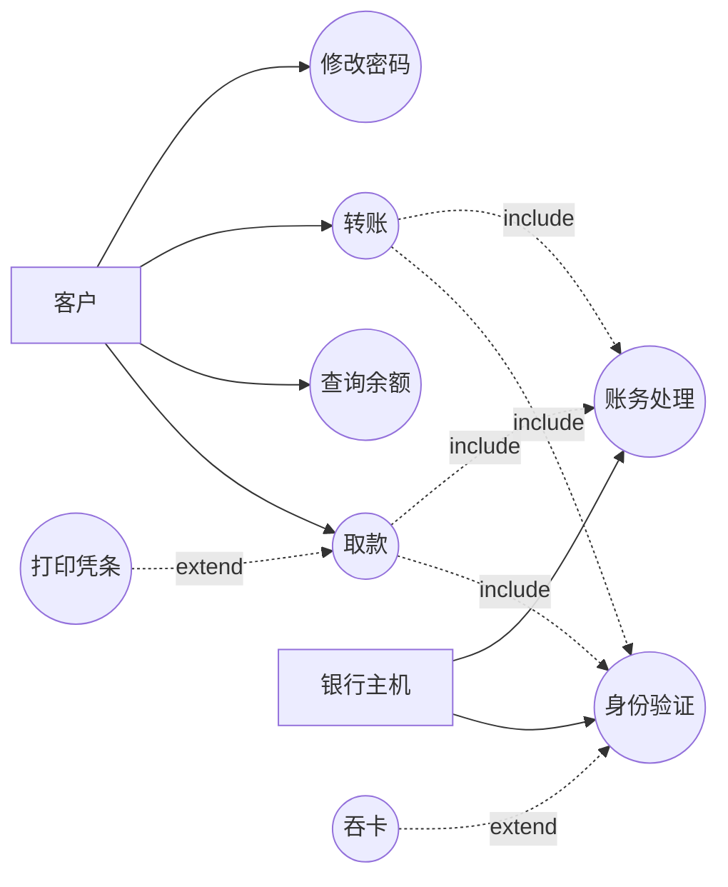

# 软件工程基础教学笔记(六):需求分析 · 结构化 · 面向对象 · 敏捷 · SDD · EA 报告

> 课程编号:26SEB06
> 主题:需求工程全貌、结构化需求分析、面向对象需求分析、敏捷需求方法、规范驱动开发(SDD)、EA 报告生成
> 前置:26SEB01-05(软件工程基础、三要素、Git/WBS/Gantt、结构化分析、OOA/UML/EA/Vibe Coding)
> 主线案例:ATM 银行系统;行业案例:油气田智能管控平台(第 8 章)

---

## 目录

1. [需求分析概述](#1-需求分析概述)
2. [结构化需求分析](#2-结构化需求分析)
3. [面向对象需求分析](#3-面向对象需求分析)
4. [敏捷需求方法](#4-敏捷需求方法)
5. [规范驱动开发 SDD](#5-规范驱动开发-sdd)
6. [EA 报告生成](#6-ea-报告生成)
7. [ATM 需求分析实战:三法贯通](#7-atm-需求分析实战三法贯通)
8. [行业实战:油气田智能管控平台需求建模](#8-行业实战油气田智能管控平台需求建模)
9. [方法对比与选型](#9-方法对比与选型)
10. [速览总结](#10-速览总结)

---

## 1. 需求分析概述

### 1.1 什么是需求

**需求(Requirement)** 是对系统"必须做什么"和"必须达到什么约束"的描述,是软件生命周期的起点,也是后续设计、编码、测试的唯一依据。

| 层次 | 名称 | 回答的问题 | 典型产物 |
|------|------|-----------|----------|
| 业务需求 | Business Requirement | 为什么要做这个系统? | 项目愿景、商业目标 |
| 用户需求 | User Requirement | 用户要用它完成什么任务? | 用例、用户故事 |
| 系统需求 | System Requirement | 系统必须提供什么功能与质量? | SRS 需求规格说明书 |
| 详细需求 | Detailed Requirement | 具体输入输出、规则、界面是什么? | 用例规约、原型、数据字典 |

> 💡 **需求的本质是"约束"**:越早写清楚约束,后期返工越少。

### 1.2 需求工程五大活动

```
需求获取 → 需求分析 → 需求规格说明 → 需求验证 → 需求管理
( Elicitation) (Analysis)  (Specification)  (Validation) (Management)
```

| 活动 | 目标 | 常用技术 |
|------|------|----------|
| **获取** | 把隐性需求挖出来 | 访谈、问卷、观察、原型、头脑风暴、文档分析 |
| **分析** | 去伪存真、消除冲突、建立模型 | DFD、ERD、用例图、类图、优先级排序 |
| **规格说明** | 写成可评审的文档 | SRS、用例规约、用户故事、验收标准 |
| **验证** | 确认"写对了、写全了" | 评审、原型确认、可追溯性检查、测试用例反推 |
| **管理** | 控制需求变更 | 变更请求、基线、影响分析、CCB 审批 |

### 1.3 好需求的五大特征

| 特征 | 英文 | 说明 | ATM 反例 |
|------|------|------|----------|
| **完整** | Complete | 不缺功能、不缺边界 | 只写"能取款",没写限额规则 |
| **一致** | Consistent | 需求之间不矛盾 | 一处写单笔 5000,一处写 20000 |
| **无歧义** | Unambiguous | 只有一种理解 | "取款要快"——多快算快? |
| **可验证** | Verifiable | 能用测试判定是否满足 | "界面友好"无法测 |
| **可追溯** | Traceable | 需求→设计→代码→测试可追 | 找不到某功能对应哪条需求 |

### 1.4 需求错误的代价

| 发现阶段 | 修复成本(相对) | 说明 |
|----------|----------------|------|
| 需求阶段 | **1 倍** | 改一行文字 |
| 设计阶段 | 5 倍 | 改模型、改架构 |
| 编码阶段 | 10 倍 | 改代码、改测试 |
| 测试阶段 | 20-50 倍 | 返工 + 回归测试 |
| 上线后 | **100 倍以上** | 热修复、数据修复、信誉损失 |

> 💡 **Boehm 曲线**:缺陷发现越晚,修复成本呈指数上升。这正是需求分析被称为"最便宜的质量投资"的原因。

### 1.5 需求分析的四大流派

| 流派 | 核心理念 | 代表模型 | 适用场景 |
|------|----------|----------|----------|
| **结构化** | 数据流动,自顶向下分解 | DFD + ERD + 数据字典 | 数据密集、流程稳定 |
| **面向对象** | 对象交互,封装与抽象 | UML 用例图 + 类图 | 交互复杂、业务对象多 |
| **敏捷** | 价值优先,拥抱变化 | 用户故事 + Backlog | 需求频繁变化 |
| **规范驱动(SDD)** | 先写规范,规范即唯一真相 | Spec + 验收标准 + AI 生成 | AI 辅助开发、契约优先 |

---

## 2. 结构化需求分析

### 2.1 核心思想

结构化分析(Structured Analysis, SA)由 Yourdon、DeMarco、Gane-Sarson 等人在 1970 年代提出,核心是:

> **自顶向下、逐层分解,用"数据流"描述系统功能,用"数据关系"描述系统数据。**

三条基本原则:

1. **抽象与分解**:先看整体黑盒(0 层),再逐层展开(1 层、2 层…)
2. **数据与处理分离**:ERD 管数据,DFD 管加工
3. **图形化表达**:用统一符号代替大段文字

### 2.2 SA 五件套

| 工具 | 作用 | 回答的问题 |
|------|------|-----------|
| **DFD 数据流图** | 描述数据流动与加工 | 数据从哪来、经过什么处理、到哪去 |
| **ERD 实体关系图** | 描述数据结构 | 有哪些实体、什么关系 |
| **数据字典** | 定义 DFD 中每个数据项 | 每个数据流/数据存储的精确含义 |
| **处理说明** | 描述最底层加工的判定逻辑 | 这个加工内部怎么算 |
| **STD 状态转换图** | 描述实体状态变化 | 什么事件导致状态改变 |

> 详见 26SEB04.md。本节聚焦"需求分析视角"下的用法。

### 2.3 DFD 分层:需求逐层细化

| 层 | 名称 | 内容 | 需求价值 |
|----|------|------|----------|
| 0 层 | 上下文图 | 系统整体 + 外部实体 | 划定系统边界,明确"谁跟系统交互" |
| 1 层 | 顶层分解 | 主要加工 + 数据存储 | 功能模块划分,对应需求分组 |
| 2 层 | 详细分解 | 子加工 + 细数据流 | 每个功能的具体输入输出 |

**平衡原则**(父子图平衡):子图的输入输出数据流必须与父图中对应加工的输入输出一致,不能凭空多出或丢失数据流。这是需求完整性检查的硬手段。

### 2.4 结构化需求分析的产出

| 产出 | 对应需求层次 | 用途 |
|------|-------------|------|
| 系统上下文图 | 系统需求 | 界定范围 |
| DFD 分层图 | 功能需求 | 功能分解与接口 |
| ERD | 数据需求 | 数据模型 |
| 数据字典 | 详细需求 | 字段级定义 |
| 处理说明(判定表/判定树) | 详细需求 | 业务规则 |
| STD | 行为需求 | 状态约束 |

### 2.5 优缺点

| 优点 | 缺点 |
|------|------|
| 图形直观,便于与业务方沟通 | 以功能为中心,难以体现对象复用 |
| 分层细化,适合大型系统 | 需求变更时,所有层级的图都要改 |
| 数据与处理分离,职责清晰 | 难以表达继承、多态等面向对象特性 |
| 平衡原则可机械检查完整性 | 对交互密集系统(如 GUI)表达力弱 |

### 2.6 ATM 结构化需求片段

**0 层上下文图**

```
[客户] ──插卡/输密/取款请求──→ ( ATM 银行系统 ) ──出钞/凭条/提示──→ [客户]
[银行主机] ←──验密/扣款请求── ( ATM 银行系统 ) ──账户/流水──→ [银行主机]
[运维人员] ←──故障告警── ( ATM 银行系统 )
```

**1 层 DFD 主要加工**

| 编号 | 加工名 | 输入 | 输出 |
|------|--------|------|------|
| P1 | 身份验证 | 卡号、PIN | 验证结果 |
| P2 | 交易受理 | 交易类型、金额 | 交易请求 |
| P3 | 额度与余额校验 | 交易请求、账户数据 | 校验结果 |
| P4 | 记账与出钞 | 校验通过、扣款指令 | 流水、现金 |

**处理说明(取款判定)**

| 条件 | 规则编号 | 动作 |
|------|----------|------|
| 金额 ≤ 0 或非 100 倍数 | R1 | 拒绝:"金额无效" |
| 金额 > 单笔限额 5000 | R2 | 拒绝:"超单笔限额" |
| 当日累计 + 金额 > 20000 | R3 | 拒绝:"超日限额" |
| 金额 > 余额 | R4 | 拒绝:"余额不足" |
| 以上均通过 | R5 | 扣款 + 出钞 + 写流水 |

---

## 3. 面向对象需求分析

### 3.1 核心思想

面向对象分析(Object-Oriented Analysis, OOA)以**对象**为基本单位,把系统看作一组**互相协作的对象**。

> **不是问"数据怎么流",而是问"有哪些对象、它们各自负责什么、如何协作"。**

三条原则:**封装**(数据与行为绑定)、**继承**(共性抽取)、**多态**(同一接口不同实现)。

### 3.2 OOA 需求建模的两大核心产物

| 产物 | 作用 | 需求视角的价值 |
|------|------|----------------|
| **用例图** | 谁使用系统、能做哪些事 | 需求范围与功能清单 |
| **用例规约** | 每个用例的完整流程与异常 | 详细需求与验收标准 |
| **领域类图(概念类图)** | 业务中有哪些概念对象、关系 | 领域词汇表、数据需求 |

> 注意区分:**需求阶段的类图是"概念类图"**(只画业务概念,不含技术细节),设计阶段才细化为"设计类图"(含方法签名、可见性)。

### 3.3 用例建模四步法

```
1. 识别参与者(Actor)        → 谁与系统交互?
2. 识别用例(Use Case)       → 每个参与者要做什么?
3. 编写用例规约              → 主流程 + 备选流程 + 异常
4. 绘制用例图并评审          → 确认范围
```

### 3.4 用例规约模板(需求的核心载体)

| 字段 | 说明 | ATM 取款示例 |
|------|------|-------------|
| 用例编号 | 唯一标识 | UC-01 |
| 用例名称 | 动宾结构 | 取款 |
| 参与者 | 主要 + 次要 | 客户(主)、银行主机(次) |
| 前置条件 | 执行前必须成立 | 卡已插入、密码已验证 |
| 触发条件 | 什么事件启动 | 客户点击"取款" |
| 主成功流 | 正常路径 | 1.选择取款 2.输入金额 3.校验 4.扣款 5.出钞 6.打印凭条 |
| 备选流 | 其他合法路径 | 3a.客户取消 → 退卡 |
| 异常流 | 失败路径 | 4a.余额不足→提示;5a.出钞故障→冲正 |
| 后置条件 | 执行后状态 | 余额减少、流水已记、现金已出 |
| 业务规则 | 约束 | 金额为 100 倍数、单笔≤5000、日累计≤20000 |

> 💡 **用例规约 = 结构化"处理说明"的面向对象等价物**,但更强:它同时表达了正常流、异常流与后置状态。

### 3.5 领域类图:从名词中找对象

**名词提取法**:

```
需求描述 → 划出名词 → 候选类 → 排除(属性/同义词/外部实体) → 确定类
```

ATM 需求中的名词:"客户、银行卡、账户、密码、余额、交易、金额、凭条、ATM 终端、银行主机、流水"

| 候选名词 | 判定 | 理由 |
|----------|------|------|
| 客户、银行卡、账户、交易、ATM 终端 | ✅ 类 | 有属性、有行为、长期存在 |
| 余额、金额、密码 | ❌ 属性 | 属于某个类的特征 |
| 凭条 | ⚠️ 可为类也可为属性 | 若需独立管理打印状态则建类 |
| 银行主机 | ⚠️ 外部系统 | 通常建模为外部参与者/接口 |

### 3.6 ATM 用例图(Mermaid)



### 3.7 优缺点

| 优点 | 缺点 |
|------|------|
| 贴近业务语言,业务方易理解 | 需要团队具备 OO 思维 |
| 用例规约天然覆盖正常/异常流程 | 用例粒度难以把握 |
| 对象模型可平滑过渡到设计 | 对纯数据批处理场景偏重 |
| 便于识别复用点 | 领域建模需要业务专家深度参与 |

---

## 4. 敏捷需求方法

### 4.1 核心理念

《敏捷宣言》对需求的态度:

> **"响应变化 高于 遵循计划"**、**"可工作的软件 高于 详尽的文档"**

敏捷不是"不写需求",而是**把需求切成小块、边做边确认、持续调整**。

### 4.2 用户故事(User Story)

**标准句式**:

```
作为 <角色>,我希望 <功能>,以便 <价值>
```

**ATM 示例**:

| 编号 | 用户故事 |
|------|----------|
| US-01 | 作为**客户**,我希望**插入银行卡后输入密码**,以便**验证身份后使用服务** |
| US-02 | 作为**客户**,我希望**选择取款并输入金额**,以便**取出所需现金** |
| US-03 | 作为**客户**,我希望**在余额不足时得到明确提示**,以便**知道为什么取不出钱** |
| US-04 | 作为**银行风控人员**,我希望**单笔取款不超过 5000 元**,以便**控制资金风险** |

### 4.3 INVEST 原则:好故事的标准

| 字母 | 含义 | 说明 | ATM 反例 |
|------|------|------|----------|
| **I**ndependent | 独立 | 故事之间少依赖,可独立排期 | "取款(依赖转账先做完)" |
| **N**egotiable | 可协商 | 细节可讨论,不是合同 | 故事里写死 37 个字段 |
| **V**aluable | 有价值 | 对用户或业务有明确价值 | "重构数据库连接池"(技术任务,非故事) |
| **E**stimable | 可估算 | 团队能估出工作量 | "让系统更好用" |
| **S**mall | 小 | 一个 Sprint 内能完成 | "实现整个银行核心系统" |
| **T**estable | 可测试 | 有明确验收标准 | "界面要美观" |

### 4.4 验收标准(Acceptance Criteria)

用户故事必须配套**可测试的验收标准**,常用 **Given-When-Then** 格式:

| 场景 | Given(前提) | When(动作) | Then(预期) |
|------|-------------|-----------|-----------|
| 正常取款 | 余额 1000,已验密 | 取款 500 | 成功出钞 500,余额变 500 |
| 余额不足 | 余额 100 | 取款 500 | 提示"余额不足",不出钞 |
| 超单笔限额 | 已验密 | 取款 6000 | 提示"超单笔限额" |
| 非百元倍数 | 已验密 | 取款 150 | 提示"金额须为 100 倍数" |
| 日累计超限 | 当日已取 19000 | 取款 2000 | 提示"超日累计限额" |

> 💡 **Given-When-Then 就是"需求阶段写好的测试用例"**,可直接交给测试工程师执行。

### 4.5 需求分层:Epic → Story → Task

```
Epic(史诗)          ATM 系统建设
  └── Feature(特性)      取款业务
        └── Story(故事)   客户取款
              └── Task(任务)   [前端] 金额输入页
                               [后端] 取款接口
                               [后端] 余额校验
                               [测试] 取款用例
```

| 层级 | 粒度 | 负责 |
|------|------|------|
| Epic | 数月,跨多个迭代 | 产品经理 |
| Feature | 数周 | 产品经理 + 团队 |
| Story | 数天,一个 Sprint 内 | 团队共同拆分 |
| Task | 数小时 | 开发个人 |

### 4.6 优先级排序方法

| 方法 | 说明 | ATM 应用 |
|------|------|----------|
| **MoSCoW** | Must / Should / Could / Won't | Must:取款;Should:查余额;Could:转账;Won't:理财 |
| **Kano 模型** | 基本型 / 期望型 / 兴奋型 | 能取钱=基本型;取款快=期望型;刷脸取款=兴奋型 |
| **价值-成本矩阵** | 高价值低成本优先 | 取款(高价值低复杂度)先做 |
| **故事点 + 速率** | 相对估算 + 团队速率 | 团队速率 20 点/Sprint,取款估 8 点 |

### 4.7 产品待办列表(Product Backlog)

| 优先级 | 条目 | 类型 | 故事点 | 状态 |
|--------|------|------|--------|------|
| 1 | 插卡与身份验证 | Story | 5 | Done |
| 2 | 取款 | Story | 8 | In Sprint |
| 3 | 查询余额 | Story | 3 | Ready |
| 4 | 转账 | Story | 8 | Ready |
| 5 | 打印凭条 | Story | 2 | Backlog |
| 6 | 修改密码 | Story | 3 | Backlog |

> Backlog 是**动态的**:每个 Sprint 开始前重新排序,新需求随时插入(由产品负责人决定优先级)。

### 4.8 敏捷需求 vs 传统需求

| 维度 | 传统(SA/OOA) | 敏捷 |
|------|---------------|------|
| 需求文档 | 完整 SRS,一次写全 | 用户故事 + 验收标准,逐步细化 |
| 变更 | 变更控制委员会审批 | 下个 Sprint 直接调整 |
| 粒度 | 系统级、完整 | 故事级、可交付价值 |
| 确认时机 | 需求评审会一次性确认 | 每个 Sprint 评审会持续确认 |
| 需求方角色 | 需求提供者 | 产品负责人(常驻团队) |
| 适用 | 合同型、合规型项目 | 互联网、探索型产品 |

---

## 5. 规范驱动开发 SDD

### 5.1 什么是 SDD

**SDD(Spec-Driven Development,规范驱动开发)** 是一种**以规范(Spec)为唯一真相源**的开发范式:

> **先把"要做什么"写成机器可读、可执行的规范,再由人或 AI 依据规范生成设计、代码与测试。**

传统开发中,文档写完就过期;SDD 中,**规范是活的、可执行的、被持续验证的**。

| 对比 | 传统文档驱动 | 规范驱动 SDD |
|------|-------------|-------------|
| 真相源 | 代码(文档常过期) | **规范**(代码由规范生成) |
| 规范形态 | 自然语言 Word/PDF | **结构化 + 可验证 + 机器可读** |
| 一致性 | 靠人工同步 | 规范变更 → 自动/半自动传导到代码 |
| 验收 | 测试独立编写 | 验收标准直接来自规范 |
| AI 角色 | 事后补代码 | **依据规范生成,规范即 Prompt** |

### 5.2 SDD 的四层规范

| 层级 | 名称 | 内容 | ATM 示例 |
|------|------|------|----------|
| L1 | 产品规范(Product Spec) | 目标、范围、用户、价值 | ATM 取款子系统 |
| L2 | 功能规范(Functional Spec) | 功能清单、流程、规则 | 取款:验密→限额→余额→扣款→出钞 |
| L3 | 接口规范(API Spec) | 入参、出参、错误码、协议 | `POST /api/withdraw` |
| L4 | 验收规范(Acceptance Spec) | 可执行的验收条件 | Given-When-Then 用例 |

### 5.3 SDD 工作流

```
1. 写规范(Spec)
   ├── 业务目标与范围
   ├── 功能流程(含异常)
   ├── 业务规则(限额、校验)
   └── 验收标准(Given-When-Then)
            ↓
2. 规范评审(人 + 利益相关方)
            ↓
3. 生成实现(人 / AI / MDG)
   ├── 设计文档
   ├── 代码骨架
   ├── 测试用例
   └── API 文档
            ↓
4. 自动化验证
   └── 验收标准 → 自动化测试 → 回归
            ↓
5. 规范变更管理
   └── 改规范 → 影响分析 → 再生成 → 再验证
```

### 5.4 SDD 规范示例(ATM 取款)

```yaml
spec:
  id: ATM-WITHDRAW-001
  title: 客户取款
  version: 1.2.0
  actor: 客户
  preconditions:
    - 银行卡已插入且状态为正常
    - 密码验证通过
  rules:
    - id: R1
      condition: amount <= 0 || amount % 100 != 0
      error: E1001  # 金额无效
    - id: R2
      condition: amount > 5000
      error: E1002  # 超单笔限额
    - id: R3
      condition: daily_total + amount > 20000
      error: E1003  # 超日累计限额
    - id: R4
      condition: amount > balance
      error: E1004  # 余额不足
  main_flow:
    - 校验规则 R1-R4
    - 开启事务:扣减余额 + 写入交易流水
    - 出钞
    - 打印凭条
  exceptions:
    - 出钞失败: 事务回滚,记录异常流水,提示客户
  acceptance:
    - given: { balance: 1000, daily_total: 0 }
      when:  { amount: 500 }
      then:  { status: SUCCESS, balance: 500 }
    - given: { balance: 100 }
      when:  { amount: 500 }
      then:  { status: FAIL, error: E1004 }
```

> 💡 **这份 YAML 同时是需求、设计输入、测试用例来源、AI Prompt**——一次编写,四处复用,这是 SDD 的核心价值。

### 5.5 规范示例二:Markdown + EARS 写法(真实项目片段)

上面的 YAML 适合机器解析;企业项目中也常用**纯 Markdown 规范**——可读性更好,同样能被 AI 与测试框架消费。下面是一份真实项目 spec 文件的片段(节选,原文件行号 13-30):

#### 术语前置:先定义,再使用

```markdown
- **权限码**：形如 `poi:update`、`article:delete`、`audit:log:read` 的字符串，是前端按钮级渲染与后端接口鉴权的共同依据。
- **访问令牌 / 刷新令牌**：JWT，分别有效期 30 分钟与 7 天，后者只存放在 HttpOnly Cookie。
- **敏感操作**：A/B/C 三个模块的任何写操作（新建、修改、删除、批量导入、发布），以及 D 模块的数据导出。
```

> 💡 这三行**术语表**是规范质量的关键:把"权限码""敏感操作"这类易产生歧义的词先钉死,后文所有规则才有共同语言(呼应 1.3 节"无歧义"特征)。

#### 需求条目结构

```markdown
## Requirements

### Requirement 1: 账号密码登录

**User Story:** 作为已注册的编辑或管理员，我要用账号密码登录，以便进入系统并只看到我角色允许的功能。

#### Acceptance Criteria

1. WHEN 用户提交有效的 `username` 与 `password`，THE SYSTEM SHALL 返回 `accessToken`、`refreshToken`、`expiresIn`（1800 秒）与 `user`（含 `roles`、`permissions` 两个数组）。
2. IF 账号不存在或密码错误，THEN THE SYSTEM SHALL 返回 `401`，且错误体为 `{code, message, traceId}`，不区分「账号不存在」与「密码错误」，不泄露账号是否存在。
3. IF 同一账号连续 5 次密码错误，THEN THE SYSTEM SHALL 锁定该账号 15 分钟，锁定期返回 `423`。
4. WHEN 登录成功，THE SYSTEM SHALL 写入一条 `action:user:login`、`result:success` 的审计日志，记录 `userId`、`ip`、`createdAt`。
```

#### 为什么用 EARS 句式

这四条验收标准采用的是 **EARS(Easy Approach to Requirements Syntax,简易需求语法)** 模板:

| 句式 | 触发关键字 | 适用场景 | 上例对应 |
|------|-----------|----------|----------|
| 事件驱动 | `WHEN ... THE SYSTEM SHALL ...` | 某个事件发生时的行为 | 条目 1、4 |
| 条件驱动 | `IF ... THEN THE SYSTEM SHALL ...` | 异常/前置条件分支 | 条目 2、3 |
| 状态驱动 | `WHILE ... THE SYSTEM SHALL ...` | 处于某状态期间持续要求 | (本例未用) |
| 特性驱动 | `WHERE ... THE SYSTEM SHALL ...` | 仅特定配置/变体下适用 | (本例未用) |
| 普遍式 | `THE SYSTEM SHALL ...` | 无条件的恒定约束 | (如"SHALL 使用 HTTPS") |

> **EARS 的价值**:强制每条需求都以"主语 + SHALL + 可观测行为"收尾,天然消除"应尽量""友好""快速"这类不可验证表达——这正好落实了 1.3 节的**可验证**特征。

#### 四条标准里的需求工程要点

| 条目 | 隐含的需求设计考量 |
|------|-------------------|
| 1 | 明确输出字段与有效期(1800 秒),不留"合理时长"的模糊 |
| 2 | **安全需求**:统一 401 错误,不区分账号/密码错误——防用户枚举攻击 |
| 3 | 异常流:锁定 15 分钟 + 独立状态码 423,可被测试精确断言 |
| 4 | **审计需求**:敏感行为必须留痕,字段级明确(userId/ip/createdAt) |

> 💡 **对比本章 5.4 的 YAML**:YAML 强在结构化、可直接驱动生成;Markdown+EARS 强在人可读、评审友好。**两者可共存**——用 Markdown 写规范和评审,再抽取为 YAML/JSON 交给 AI 生成代码与测试。

### 5.6 SDD 与 AI 的结合

| 环节 | AI 的作用 |
|------|-----------|
| 规范撰写 | 根据会议记录/需求草稿生成初版 Spec |
| 规范检查 | 检查歧义、遗漏、规则冲突 |
| 代码生成 | 依据 Spec 生成 Controller/Service/DAO |
| 测试生成 | 把 acceptance 直接转为测试用例 |
| 变更影响分析 | Spec 改动后指出受影响的代码与测试 |

> 业界已有 **GitHub Spec Kit** 等工具实践这一范式:以 spec 目录组织规范,由 AI 依据规范生成实现。SDD 与 26SEB05 的 **Vibe Coding** 的区别是:**Vibe Coding 以自然语言对话为输入,SDD 以结构化规范为输入**——后者更可审计、更适合企业级与合规场景。

### 5.7 SDD 的优缺点

| 优点 | 缺点 |
|------|------|
| 规范即真相,杜绝文档过期 | 前期写规范成本较高 |
| 可追溯性强,适合合规/金融 | 规范语言与工具链尚在成熟中 |
| 天然适配 AI 生成与自动化测试 | 业务方难以直接读写结构化规范 |
| 变更影响可分析 | 过度规范化可能拖慢探索型项目 |

---

## 6. EA 报告生成

### 6.1 为什么需要 EA 报告

Enterprise Architect(EA)不只是画图工具,它的模型仓库中包含**需求、用例、类、组件、测试**等全部元素及其**关联关系**。EA 的文档生成(Document Generation)可以把这些模型**自动导出为交付文档**。

| 痛点 | EA 报告的解决方式 |
|------|------------------|
| 需求文档手工编写,易与模型脱节 | 从模型直接生成,模型变则文档变 |
| 评审时看不到需求与设计的对应关系 | 自动生成**可追溯性矩阵** |
| 交付物格式不统一 | 统一模板,批量输出 |
| 合规审计需要完整证据链 | 需求→设计→实现→测试 全链路导出 |

### 6.2 EA 报告的类型

| 类型 | 输出格式 | 典型用途 |
|------|----------|----------|
| **文档报告(Document)** | DOCX / PDF / RTF / HTML | 需求规格说明书、设计说明书 |
| **模型报告(Model Report)** | HTML | 浏览器中浏览整个模型结构 |
| **可追溯性矩阵(Traceability Matrix)** | HTML / CSV | 需求覆盖分析 |
| **元素列表(Element List)** | CSV / HTML | 需求清单、缺陷清单 |
| **图表包(Diagram)** | 图片 / PDF | 批量导出全部图形 |

### 6.3 标准报告模板结构(需求规格说明书)

```
1. 封面与版本信息
2. 目录
3. 引言(目的、范围、术语、参考)
4. 总体描述(业务背景、用户角色、约束)
5. 功能需求
   ├── 5.1 用例列表(从用例图生成)
   ├── 5.2 用例详情(从用例规约生成)
   └── 5.3 业务规则(从约束元素生成)
6. 数据需求(从概念类图/ERD 生成)
7. 非功能需求(性能、安全、可用性)
8. 需求追踪矩阵(需求 → 设计 → 测试)
9. 附录(术语表、变更记录)
```

### 6.4 可追溯性矩阵:需求分析的质量证据

EA 的 Traceability Matrix 自动展示元素间的关联,是需求完整性的客观证据。

| 需求 ID | 需求名称 | 设计元素 | 实现类 | 测试用例 | 覆盖状态 |
|---------|----------|----------|--------|----------|----------|
| REQ-01 | 身份验证 | UC-05 | AuthService | TC-001~005 | ✅ 已覆盖 |
| REQ-02 | 取款 | UC-01 | AccountService.withdraw | TC-010~018 | ✅ 已覆盖 |
| REQ-03 | 限额控制 | UC-01 | LimitValidator | TC-012 | ✅ 已覆盖 |
| REQ-04 | 出钞 | UC-01 | Dispenser | TC-016 | ⚠️ 部分覆盖 |
| REQ-05 | 打印凭条 | UC-07 | PrinterService | — | ❌ 未覆盖 |

> 💡 矩阵中出现"❌ 未覆盖"的需求,就是**需求遗漏或测试遗漏**的直接证据——这正是需求验证活动要找的东西。

### 6.5 EA 报告生成操作步骤

| 步骤 | 操作 | 说明 |
|------|------|------|
| 1 | 打开模型所在 Package | 选定报告范围 |
| 2 | `Publish → Document Generation`(或 `F8`) | 打开生成对话框 |
| 3 | 选择模板 | 内置模板或自定义模板 |
| 4 | 设置输出格式与路径 | DOCX / PDF / HTML |
| 5 | 配置选项 | 是否含图、是否含子包、是否含空章节 |
| 6 | 生成 | 一键输出 |
| 7 | 评审与归档 | 纳入配置管理(Git) |

### 6.6 EA 报告在需求分析中的价值

| 价值 | 说明 |
|------|------|
| **一致性** | 文档与模型同源,不会出现"图改了文档没改" |
| **效率** | 数百页规格说明书分钟级生成 |
| **可追溯** | 每条需求可追到设计与测试 |
| **合规** | 满足 CMMI、ISO 26262、DO-178C 等审计要求 |
| **协作** | 业务方拿到的是可读的 Word/PDF,而非建模工具 |

### 6.7 与其他工具的关系

| 工具 | 定位 |
|------|------|
| **EA** | 建模 + 报告生成 + 可追溯性(26SEB05 已介绍 MDG) |
| **Jira / 飞书项目** | 敏捷需求(用户故事)管理 |
| **Confluence / 飞书文档** | 需求协作文档 |
| **Git** | 规范与代码的版本管理(26SEB03) |

> 现代实践常做**组合**:Jira 管敏捷故事,EA 管正式模型与合规报告,Git 管规范与代码版本。

---

## 7. ATM 需求分析实战:三法贯通

### 7.1 同一需求,三种表达

以"**客户取款**"为例:

**① 结构化表达(DFD + 处理说明)**

```
[客户] --取款请求--> (P2 交易受理) --交易指令--> (P3 校验) --通过--> (P4 记账出钞) --> [客户]
                            ^                      |
                            |                      v
                      [D1 账户数据]          [D2 交易流水]
```

处理说明用判定表(R1-R5)描述校验规则。

**② 面向对象表达(用例规约 + 类图)**

```
UC-01 取款
参与者:客户、银行主机
主成功流:选择取款 → 输入金额 → Account.withdraw() → Transaction.record() → Dispenser.dispense()
异常流:E1001 金额无效 / E1002 超限额 / E1004 余额不足 / 出钞故障冲正
```

**③ 敏捷表达(用户故事 + 验收标准)**

```
US-02 作为客户,我希望选择取款并输入金额,以便取出所需现金。
验收:
  Given 余额 1000, When 取款 500, Then 成功出钞且余额 500
  Given 余额 100,  When 取款 500, Then 提示 E1004
```

**④ SDD 表达(结构化规范)**

见 5.4 节 YAML:rules + main_flow + acceptance,可被 AI 直接消费。

### 7.2 四种表达的对应关系

| 需求要素 | 结构化 | 面向对象 | 敏捷 | SDD |
|----------|--------|----------|------|-----|
| 外部参与者 | 外部实体 | Actor | 角色 | actor |
| 功能 | 加工 P | 用例 UC | 用户故事 | feature |
| 流程 | 数据流 + 处理说明 | 主成功流 | 故事描述 | main_flow |
| 业务规则 | 判定表 | 业务规则 | 验收标准 | rules |
| 异常 | 备选数据流 | 异常流 | 验收标准(失败场景) | exceptions |
| 数据 | ERD + 字典 | 概念类图 | (隐含) | spec 字段 |

### 7.3 完整需求追踪链

```
业务目标:提升 ATM 自助服务效率
   └── 需求 REQ-02:支持客户取款
         ├── 用例 UC-01:取款
         │     ├── 设计:AccountService.withdraw()
         │     │     ├── 代码:AccountService.java
         │     │     └── 测试:TC-010~TC-018
         │     └── 规则 R1-R4 → LimitValidator
         └── 验收:Given-When-Then 5 条
```

> 这条链在 EA 中体现为**可追溯性矩阵**,在敏捷中体现为**故事 ↔ 测试用例**,在 SDD 中体现为**spec ↔ 生成代码 ↔ 自动化测试**。

### 7.4 方法混用的现实建议

| 场景 | 建议组合 |
|------|----------|
| 银行核心系统(合规重) | EA 模型 + SDD 规范 + 敏捷迭代交付 |
| 互联网产品(变化快) | 敏捷用户故事 + 轻量用例规约 |
| 数据处理系统(流程稳定) | 结构化 DFD + ERD |
| 复杂业务中台 | OOA 用例/领域模型 + SDD 接口规范 |
| AI 辅助开发团队 | SDD 规范 + Vibe Coding 生成 |

---

## 8. 行业实战:油气田智能管控平台需求建模

> 案例来源:某《油气田智能管控平台软件开发功能报价清单》(定制开发 + 私有化部署)。这是一份真实的企业级需求文档样本——**它既是报价单,也是一份"半成品"的系统需求清单**。本节演示如何把它整理为规范的需求模型列表。

### 8.1 项目概览

| 项目要素 | 内容 |
|----------|------|
| 项目名称 | 油气田智能管控平台(地质管理 + 工程管理 + 生产管理 + SCADA 物联网 + 首页一张图 + 数据治理) |
| 交付物 | Web 平台 + PC 管理后台 + 全部源代码(私有化部署) |
| 项目工期 | 180 天 |
| 功能规模 | **7 大业务域、46 项功能** |
| 计价方式 | 800 元/人天,总计 1,548,600 元 |

### 8.2 需求分层:从报价清单到需求模型

报价清单的"业务域 → 功能"两级结构,天然对应需求分层(对照 1.1 与 4.5 节):

```
L0 项目          油气田智能管控平台
 └── L1 业务域(7)    油气藏地质管理 / 工程管理 / 生产管理 / SCADA 监控 / 一张图 / 数据治理
      └── L2 功能(46)    单井基础档案管理 / 井斜轨迹与三维建模 / ...
           └── L3 需求条目     可验证的规则与验收标准(需进一步细化)
```

| 清单层级 | 对应需求层次(1.1 节) | 敏捷对应(4.5 节) | 说明 |
|----------|----------------------|-------------------|------|
| 业务域(L01-L06) | 业务需求 | Epic | 按业务价值划分 |
| 功能名称 | 系统需求 | Feature | 报价与分工的单位 |
| 功能描述中的分号子句 | 详细需求 | Story | 每个";子能力"≈一个用户故事 |
| "两井中心距<4m 自动预警"等 | 业务规则 | 验收标准 | 可直接写成 Given-When-Then |

> 💡 注意:报价清单 ≠ 需求规格说明书。它缺少**异常流、非功能需求、明确验收标准**——这些正是需求分析阶段要补齐的。

### 8.3 需求清单总览(7 大业务域)

| 业务域 | 域编号 | 功能数 | 小计(元) | 占比 |
|--------|--------|--------|----------|------|
| 一、油气藏地质管理 | L01 | 11 | 400,400 | 25.9% |
| 二、工程管理 | L02 | 13 | 462,600 | 29.9% |
| 三、生产管理 | L03 | 5 | 146,800 | 9.5% |
| 四、SCADA 与物联网监控 | L04 | 3 | 77,000 | 5.0% |
| 五、首页一张图 | L05 | 4 | 159,200 | 10.3% |
| 六、数据及公共管理 | L06 | 5 | 136,000 | 8.8% |
| 七、基础设施与配套服务 | — | 5 | 166,600 | 10.8% |
| **合计** | | **46** | **1,548,600** | 100% |

### 8.4 需求功能列表明细(46 项)

> 将清单整理为"域 → 功能 → 核心需求点"三级列表,每项提取 2-3 个可验证的核心需求点。

**L01 油气藏地质管理域(11 项)**

| 编号 | 功能 | 核心需求点 |
|------|------|-----------|
| F01 | 单井基础档案管理 | ①单井档案增删改查 ②GIS 定位与邻井分布 ③Excel 批量导入导出 |
| F02 | 井斜轨迹与三维空间建模 | ①测斜数据生成二维投影图 ②三维空间模型(轨迹+层位+断层) ③基础数据变更自动提醒、联动更新 |
| F03 | 油气水层与岩心管理 | ①油气水层段台账 ②取心记录与 360° 环扫照片 ③综合地质柱状图在线编制 |
| F04 | 单井数字档案管理 | ①文档按标准目录挂接 ②在线预览与版本追溯 ③全文检索 |
| F05 | 实验分析数据管理 | ①X 衍射/物性数据录入 ②异常数据剔除与自动成图 ③标准化物性报告归档锁定 |
| F06 | 地质图件管理 | ①图件目录树与版本号 ②分级访问权限 ③水印保护与下载审批 |
| F07 | 地震剖面与多井对比 | ①SEG-Y 数据解析 ②剖面叠加解释成果 ③连井对比图自动生成 |
| F08 | 数据质量与标准化治理 | ①字段级/表级质量规则引擎 ②新标准发布自动触发存量检查 ③质量问题工单闭环 |
| F09 | 录井施工管理 | ①录井设计审批 ②实时采集与坐岗记录自动生成 ③关键参数异常预警 |
| F10 | 测井施工管理 | ①测井项目设计审批 ②资料处理解释 ③验收归档回写单井档案 |
| F11 | 地质导向管理 | ①随钻三维模型滚动修正 ②防碰预警(中心距<4m 或分离系数<2.0) ③随钻地质日报自动生成报送 |

**L02 工程管理域(13 项)**

| 编号 | 功能 | 核心需求点 |
|------|------|-----------|
| F12 | 钻井设计与评审管理 | ①多源数据自动关联支撑设计 ②在线评审批注 ③设计变更闭环与版本对照 |
| F13 | 在线流程与个人工作台 | ①自定义审批流引擎 ②审批留痕 ③个人待办动态展示 |
| F14 | 钻井施工监控与定向管理 | ①实时参数曲线对比设计阈值 ②单井/多井监控 ③信息投射过井剖面 |
| F15 | 固井与完井管理 | ①关键工序全过程监管 ②固井质量等级评定 ③井下复杂管理台账 |
| F16 | 钻井时效与优化分析 | ①时效分布自动统计 ②MSE/摩阻扭矩等优化分析 ③承包商排名支撑 |
| F17 | 钻井工具与井下复杂管理 | ①工具全生命周期 ②复杂故障台账与后评估 |
| F18 | 钻井液管理 | ①性能参数曲线 ②井漏事件台账 ③材料库存低于安全阈值自动预警 |
| F19 | 控压钻井管理 | ①控压方案与装备台账 ②ECD 实时计算与超限报警 ③回压/排量调整指令下达 |
| F20 | 井控管理 | ①井控装备台账与检验到期预警 ②高风险作业审批 ③人员资质过期自动预警 |
| F21 | 钻井报表与井史管理 | ①监督日报动态生成 ②应急物资预警 ③单井数字井史全周期档案 |
| F22 | 压裂方案设计与实时监控 | ①方案线上评审与变更对照 ②施工五曲线秒级监控 ③砂堵/漏失智能诊断预警 |
| F23 | 压裂监测与对比分析 | ①微地震/广域电磁/示踪剂数据展示 ②多井雷达图对比 ③排采动态实时监控 |
| F24 | 压裂数据录入与产能评价 | ①多制度产量录入与产能拟合 ②压裂秒点数据设备对接 ③全过程文档推送单井档案 |

**L03 生产管理域(5 项)**

| 编号 | 功能 | 核心需求点 |
|------|------|-----------|
| F25 | 生产计划管理 | ①年/月/日计划公司→区块→单井逐级分解 ②在线逐级审批 ③计划偏离超阈值自动预警 |
| F26 | 调度指令与预警闭环 | ①指令下达/跟踪/反馈闭环(100% 送达) ②预警监控→派发→处置→复验闭环 ③7×24 值班工作台跨班跟踪 |
| F27 | 视频监控集成 | ①视频点与生产要素关联 ②业务一键调取关联视频 |
| F28 | 生产曲线与数据采集 | ①单井/井组/区块多维生产曲线 ②SCADA 采集 + 人工填报 ③班组→单位→公司逐级审核 |
| F29 | 生产报表与实时数据 | ①报表模板可配置自动生成 ②发布信息全模块同步切换 ③实时数据按井+指标+时间粒度存储 |

**L04 SCADA 与物联网监控域(3 项)**

| 编号 | 功能 | 核心需求点 |
|------|------|-----------|
| F30 | 多协议数据采集网关 | ①OPC UA/DA、ModBus RTU/TCP、MQTT 协议适配 ②点位元数据在线配置 |
| F31 | 数据质量标识与 PLC 接入 | ①标准差/箱线图/Z-Score/DBSCAN 异常识别 ②质量码(GOOD/UNCERTAIN/BAD/OVERRIDE) ③标准化入库 |
| F32 | 数据映射规则与执行监控 | ①SCADA 点位→ODS 字段映射规则 ②转换规则库复用 ③映射任务执行监控与追溯 |

**L05 首页一张图域(4 项)**

| 编号 | 功能 | 核心需求点 |
|------|------|-----------|
| F33 | 关键指标总览与多维筛选 | ①五大专题指标卡 + 趋势图 ②管理区/区块/气田联动筛选 ③公司→区块→单井逐级下钻 |
| F34 | 钻井动态 GIS 地图 | ①二/三维 GIS 叠加井位 ②单井实时参数与视频弹窗 ③钻井日报定时自动生成 |
| F35 | 压裂与试油气动态 GIS | ①施工空间分布与实时参数 ②单井下钻至五曲线详情 ③试气成果分布展示 |
| F36 | 投产与产量监控 | ①投产进度多维统计 ②日/周/月/年产量切换 ③计划偏离 >10% 高亮警示 |

**L06 数据及公共管理域(5 项)**

| 编号 | 功能 | 核心需求点 |
|------|------|-----------|
| F37 | 数据标准管理 | ①标准草案→评审→发布流程 ②发布后自动同步校验规则库 ③版本演进链(替代标准 ID) |
| F38 | 数据质量管理 | ①完整性/唯一性/规范性/一致性/时效性五维校验 ②数据健康度评分 ③工单闭环复验 |
| F39 | 文档管理 | ①草稿/已发布/已归档状态流转 ②多条件检索与在线预览 ③下载审批与访问日志 |
| F40 | 需求管理 | ①需求提出→初审→技术评审→实施→确认 ②变更与关闭留痕 ③全生命周期审计追溯 |
| F41 | 流程管理 | ①流程定义编制与版本管理 ②节点类型(开始/审批/会签/知会/结束)配置 ③废除审批 |

**基础设施与配套服务(5 项,非功能型交付)**

| 编号 | 功能 | 核心需求点 |
|------|------|-----------|
| F42 | 服务器部署与云资源配置 | ①环境搭建与 SSL ②网络链路配置 ③边缘数据接收能力 |
| F43 | 数据库设计 | ①数据字典与 ER 图 ②全业务域实体设计 ③敏感字段加密存储 |
| F44 | 接口文档与平台集成 | ①API 文档与版本化防腐 ②集团统一认证/权限/门户集成 ③AI 功能页嵌入 |
| F45 | 安全防护与测试交付 | ①网络/数据/访问控制/审计日志 ②功能/性能/安全/兼容性测试 ③操作手册与验收支持 |
| F46 | 一年免费维护 | ①Bug 修复与运维监控 ②小功能调整(不含新需求) |

### 8.5 从清单到模型:四法的消化路径

| 需求建模任务 | 推荐方法 | 对本案例的操作 |
|--------------|----------|----------------|
| 划定系统边界 | SA 上下文图 | 外部实体:井场 PLC/RTU、集团平台、业务人员、甲方管理方 |
| 功能分解核对 | WBS 100% 校验(26SEB03) | 46 项功能即 WBS 第 2 层,校验各域之和=项目范围 |
| 核心流程建模 | DFD / 用例规约 | 如"录井实时采集→治理→预警→归档"绘制 1 层 DFD |
| 数据建模 | ERD 三层演进(26SEB04) | F43 明确产出数据字典与 ER 图:井、井斜、岩心、SCADA 点位等 |
| 敏捷排期 | Epic→Story + MoSCoW | 7 大域=7 个 Epic;F30-F32(SCADA)为 Must——无数据则一切为空 |
| 契约化交付 | SDD | 将"中心距<4m 触发预警""偏离>10% 高亮"等写成 Spec rules |
| 合规证据 | EA 可追溯性矩阵 | 46 项功能 ↔ 设计 ↔ 测试覆盖状态,验收时逐项销号 |

> 💡 **本案例的教学价值**:真实企业项目的"需求清单"往往以报价单形态出现——粒度粗、缺异常、缺验收标准。需求工程师的工作,就是把这 46 行清单细化为**可验证、可追溯、无歧义**的需求模型。

### 8.6 思考题

1. 清单中 F08 与 F38 都涉及"数据质量",二者是否重复?如何用 WBS 100% 原则判定与处理?
2. 从 F26"调度指令与预警闭环"中提取 3 条可验证的业务规则,用 Given-When-Then 表达。
3. 本案例 46 项功能若按敏捷开发,Epic/Feature/Story 三层应如何划分?以 F22 为例拆到 Story。
4. 报价清单中哪些描述属于"不可验证需求"?举例并改写为可验证形式。

---

## 9. 方法对比与选型

### 9.1 四法全景对比

| 维度 | 结构化 SA | 面向对象 OOA | 敏捷 | SDD |
|------|-----------|--------------|------|-----|
| **基本单位** | 加工 / 数据流 | 对象 / 用例 | 用户故事 | 规范条目 |
| **核心产物** | DFD、ERD、字典 | 用例图、用例规约、类图 | 故事卡、验收标准、Backlog | Spec(YAML/Markdown) |
| **需求变更** | 成本高 | 中等 | 成本低 | 中(需重生成与回归) |
| **文档量** | 大 | 中大 | 小 | 中(结构化) |
| **可追溯性** | 中(靠文档编号) | 中(靠 UML 关联) | 弱(靠工具) | **强(规范即源头)** |
| **AI 友好度** | 低 | 中 | 中 | **高** |
| **学习成本** | 中 | 高 | 低 | 中 |
| **适合规模** | 大型、流程稳定 | 大型、对象复杂 | 中小、快速迭代 | 中大型、契约/合规场景 |

### 9.2 选型决策树

```
需求是否稳定?
├── 是 → 系统是否以数据处理为主?
│         ├── 是 → 结构化 SA(DFD + ERD)
│         └── 否 → 面向对象 OOA(用例 + 类图)
└── 否 → 是否有强合规/契约要求?
          ├── 是 → SDD(规范驱动)+ 敏捷迭代
          └── 否 → 敏捷(用户故事 + Backlog)
```

### 9.3 常见误区

| 误区 | 纠正 |
|------|------|
| "敏捷不需要写需求" | 敏捷写的是**轻量、可测试**的需求(故事 + 验收标准) |
| "OOA 一定优于 SA" | 数据批处理场景 SA 更直接;二者常混用 |
| "SDD 就是把文档写详细" | SDD 的关键是**规范可执行、可验证、可驱动生成** |
| "EA 报告就是导出 PDF" | 核心价值是**模型同源 + 可追溯性矩阵** |
| "需求一次写全才能开发" | 需求是**逐步细化**的,关键是基线管理与变更控制 |

---

## 10. 速览总结

### 10.1 需求分析总口诀

> **需求是约束,越早越省钱;
> 获取→分析→规格→验证→管理,五步走完;
> 完整、一致、无歧义、可验证、可追溯,五性达标。**

### 10.2 四法口诀

> **结构化看流向,DFD 分层加平衡;
> 面向对象看用例,主流程加异常流;
> 敏捷看价值,故事加验收 Given-When-Then;
> SDD 看规范,Spec 即真相,生成即验证。**

### 10.3 工具口诀

> **EA 建模又出报告,模型同源不脱节;
> 追踪矩阵一拉出,需求设计测试全对齐;
> Git 管版本,Jira 管故事,EA 管合规,
> 工具各司其职,规范贯穿始终。**

### 10.4 核心速查表

| 问题 | 答案 |
|------|------|
| 需求工程五活动? | 获取、分析、规格说明、验证、管理 |
| 好需求五特征? | 完整、一致、无歧义、可验证、可追溯 |
| SA 五件套? | DFD、ERD、数据字典、处理说明、STD |
| OOA 需求核心产物? | 用例图、用例规约、概念类图 |
| 敏捷好故事标准? | INVEST |
| 验收标准格式? | Given-When-Then |
| SDD 的核心? | 规范为唯一真相源,可执行、可验证、驱动生成 |
| EA 报告的核心价值? | 模型同源 + 可追溯性矩阵 |
| 需求错误上线后修复成本? | 约 100 倍以上 |

### 10.5 思考题

1. 为什么说"需求阶段的缺陷修复成本最低"?用 Boehm 曲线解释。
2. 同一条"取款限额"需求,分别用 DFD 处理说明、用例规约、用户故事验收标准表达,各有什么优劣?
3. SDD 与 Vibe Coding 的输入有何本质区别?为什么 SDD 更适合金融合规场景?
4. EA 可追溯性矩阵中大量需求显示"未覆盖",说明什么?应如何处置?
5. 敏捷项目是否还需要 EA 建模?请说明理由并给出适用边界。

---

## 附录:与前后讲的关联

| 前序讲次 | 本讲衔接 |
|----------|----------|
| 26SEB01 软件生命周期 | 需求分析是生命周期的第 3 阶段,决定后续一切 |
| 26SEB01 软件危机 | 多数软件危机源于需求不明确与变更失控 |
| 26SEB02 三要素 | 需求方法、建模工具、需求管理过程 |
| 26SEB02 过程模型 | 瀑布重视完整 SRS;敏捷重视迭代确认 |
| 26SEB03 Git/WBS | 需求条目 → WBS 工作包;需求文档纳入 Git |
| 26SEB04 结构化分析 | 本讲 SA 章节的展开与需求视角重述 |
| 26SEB05 OOA/UML | 本讲 OOA 章节的延伸;用例规约深化 |
| 26SEB05 EA MDG | 本讲 EA 报告聚焦"文档与追溯",MDG 聚焦"代码生成" |
| 26SEB05 Vibe Coding | SDD 是比 Vibe Coding 更可审计的规范化形态 |

| 26SEB07 预告 | 本讲铺垫 |
|--------------|----------|
| 软件设计(架构/模块/设计模式) | 需求模型是设计的输入 |
| 详细设计与接口设计 | 用例规约与 SDD 接口规范直接指导详细设计 |
| 测试工程 | 验收标准与可追溯性矩阵是测试设计的依据 |

---

> 💡 **一句话总结**:需求分析的本质是**把模糊的业务诉求转化为可验证的约束**。结构化用"数据流"、面向对象用"用例与对象"、敏捷用"故事与验收标准"、SDD 用"可执行规范"——四种表达方式不同,但目标一致:**让团队在写第一行代码之前,就对"要做对什么"达成一致**。EA 报告则把这种一致性固化为可追溯、可审计的交付物。
